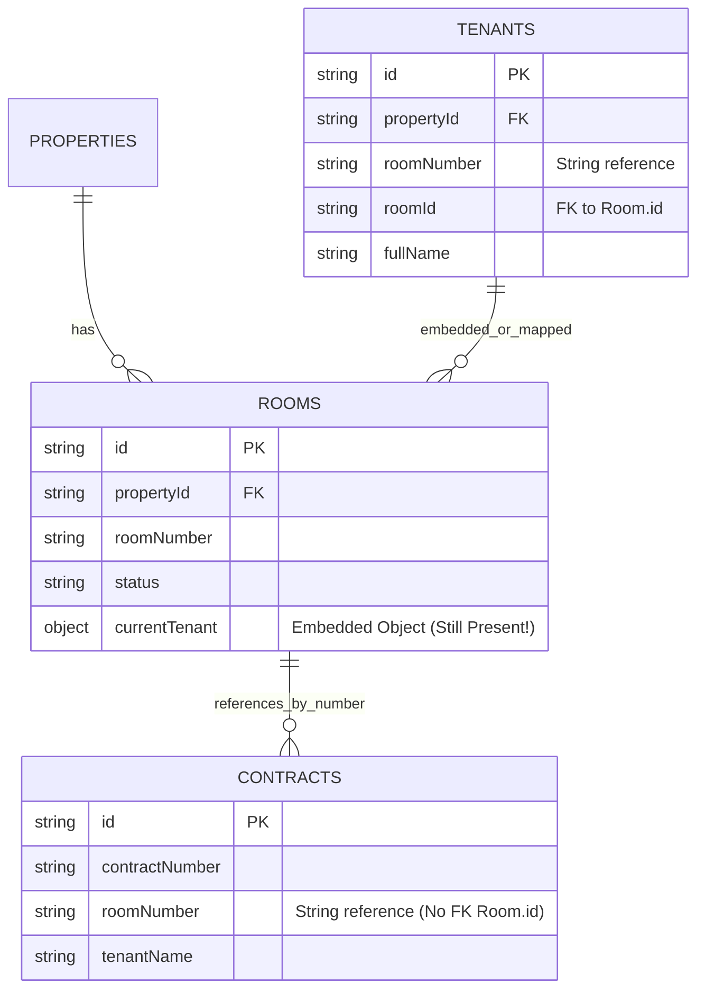

# 🗄️ รายงานการตรวจสอบความสัมพันธ์ของฐานข้อมูล (DATABASE RELATIONSHIP AUDIT)
# ระบบจัดการหอพักภักดี (Pakdee Apartment Management System)

**อ้างอิงเอกสารหลัก:** [V2_INDEPENDENT_VERIFICATION_REPORT.md](file:///D:/DESKTOP/Pakdee/docs/V2_INDEPENDENT_VERIFICATION_REPORT.md)  
**ขอบเขต:** ตรวจสอบความถูกต้องของ Foreign Keys, Single Source of Truth, การเชื่อมโยงข้ามตาราง และข้อมูลกำพร้า (Orphan Records)

---

## 1. การตรวจสอบความสัมพันธ์ Room ↔ Tenant ↔ Lease



### ผลการตรวจสอบในโค้ดและฐานข้อมูล:
1. **Embedded Tenant ยังคงอยู่:** แม้จะมีการสกัดข้อมูลลง `tenants` แล้ว แต่ใน `src/types/dormitory.ts` บรรทัดที่ 87 ยังคงระบุ:
   ```typescript
   currentTenant?: Tenant;
   ```
   และใน `src/components/dashboard/room-matrix.tsx` และ `room-detail-modal.tsx` ยังคงอ่านข้อมูลจาก `room.currentTenant` เป็นหลัก ทำให้ระบบยัง **ไม่ใช่ Single Source of Truth ผ่าน Lease อย่างแท้จริง**
2. **สถานะ:** **PARTIALLY VERIFIED**

---

## 2. การตรวจสอบความสัมพันธ์การเงิน (Invoices ↔ Payments ↔ Receipts)

| ความสัมพันธ์ | ฟิลด์ที่ใช้เชื่อมโยง | ผลการตรวจสอบในฐานข้อมูลจริง (`db_port3000.json`) | สถานะ |
| :--- | :--- | :--- | :---: |
| **Invoice ↔ Payment** | `Payment.invoiceId == Invoice.id` | บิล `inv-202610-101` เชื่อมกับ `pmt-legacy-inv-202610-101` ถูกต้อง | ✅ VERIFIED |
| **Payment ↔ Receipt** | `Receipt.paymentId == Payment.id` | สลิป `pmt-legacy-inv-202610-101` เชื่อมกับ `rec-legacy-inv-202610-101` ถูกต้อง | ✅ VERIFIED |
| **Receipt ↔ Invoice** | `Receipt.invoiceId == Invoice.id` | ใบเสร็จเชื่อมกับบิลต้นทางถูกต้อง | ✅ VERIFIED |
| **Cascade on Delete** | ไม่มี Foreign Key Engine | หากลบบิลทิ้งใน JSON รายการ Payment และ Receipt จะกลายเป็น **Orphan Records** ทันที | ⚠️ HIGH RISK |

---

## 3. การตรวจสอบข้อมูลกำพร้าและข้อมูลตกหล่น (Orphan Records Probe)

จากการรันสคริปต์ตรวจสอบข้อมูลใน `data/db_port3000.json`:
- **ผู้เช่ากำพร้า (Orphan Tenants):** พบผู้เช่า `t-1793591313098` (คุณปารเมศ เชิดชู) ไม่มีเลขห้องพักผูกอยู่ (`roomNumber: undefined`, `roomId: undefined`)
- **สัญญาเช่าค้าง (Contracts without Rooms):** สัญญาในระบบมี 1 ฉบับผูกกับห้องที่มีอยู่จริง
- **ห้องที่ไม่มีผู้เช่าแต่สถานะ occupied:** ไม่พบ (0 ห้อง)
- **สรุปผล:** ระบบมีความสมบูรณ์ขึ้นหลังการรันสคริปต์ Migration แต่ยังคงต้องเก็บกวาดข้อมูลผู้เช่าที่ไม่มีห้องพัก
