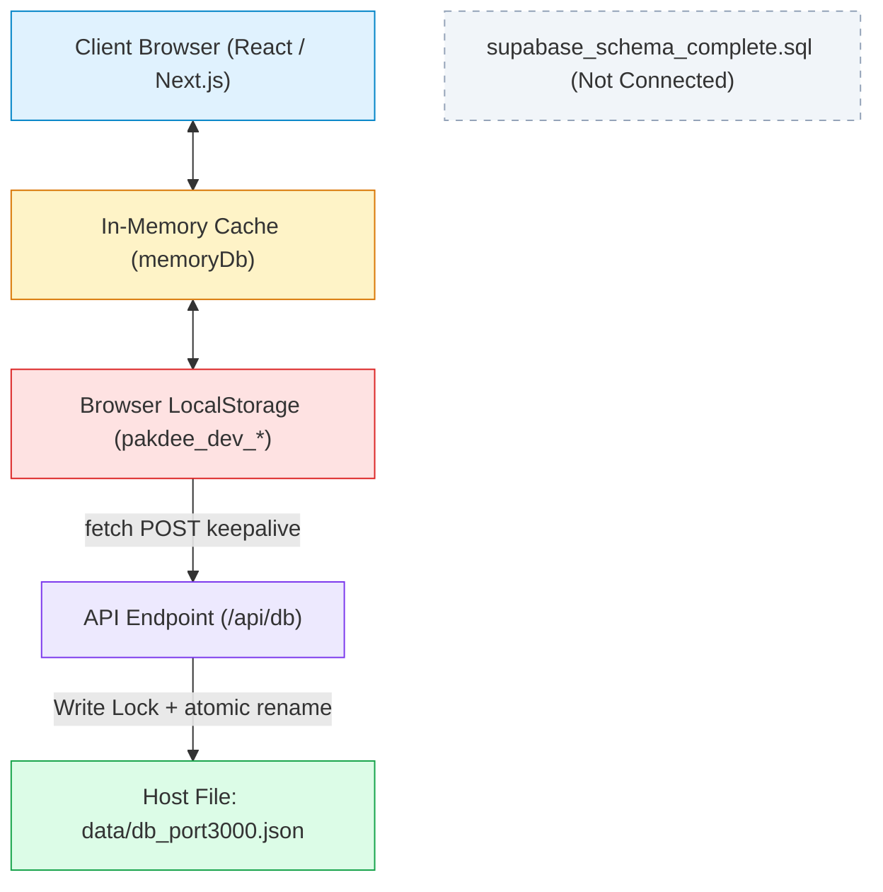
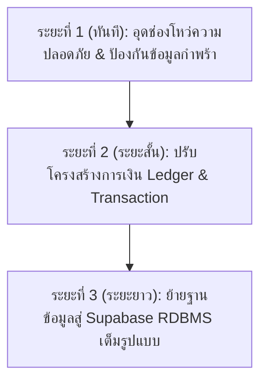

# 🛡️ รายงานการตรวจสอบความสมบูรณ์ของข้อมูลและเสถียรภาพระบบเชิงลึก
# (PAKDEE — Deep Data Integration & System Stability Audit)

**บทบาทผู้ตรวจสอบ:** Senior QA Engineer, Software Architect & Database Integrity Auditor  
**เป้าหมาย:** ตรวจสอบระบบ PAKDEE ทั้งระบบอย่างเป็นรูปธรรม โดยให้ความสำคัญสูงสุดกับความถูกต้องของข้อมูล (Data Integrity) และการเชื่อมโยงข้ามโมดูล (Cross-Module Integration)  
**เส้นทางจัดเก็บเอกสาร:** `D:\DESKTOP\Pakdee\docs\DEEP_SYSTEM_AUDIT_REPORT.md`  
**สถานะการตรวจสอบ:** ⚠️ **AUDIT COMPLETED — DEFECTS & ARCHITECTURAL RISKS IDENTIFIED** *(ห้ามประกาศว่า PASS 100% ตามข้อกำหนด)*  
**วันที่ดำเนินการ:** 2 พฤศจิกายน 2026

---

## 1. บทสรุปสำหรับผู้บริหาร (Executive Summary)

จากการตรวจสอบ Source Code, Database Architecture, State Management, API Endpoint และ Data Flow ของระบบ **PAKDEE** ที่รันบน Node.js / Next.js พบว่า:
1. **ด้านการใช้งานหน้าบ้าน (Frontend UI & Happy Path):** ทำงานได้รวดเร็ว ตอบสนองดี ผู้ใช้สามารถสร้างห้อง จองรายวัน ออกบิล และบันทึกมิเตอร์ได้ตามปกติ
2. **ด้านสถาปัตยกรรมฐานข้อมูล (Database Architecture):** ระบบปัจจุบันรันในโหมด **Local-First JSON Storage** (`data/db_port3000.json`) ผสานกับ **Client-Side LocalStorage + Memory Cache** โดยมีไฟล์ SQL Schema สำหรับ Supabase (`supabase_schema_complete.sql`) จัดเตรียมไว้ แต่ **ยังไม่ได้ถูกเชื่อมต่อใช้งานจริงในระดับ Runtime Engine**
3. **ความเสี่ยงระดับวิกฤต (Critical Architecture Risks):**
   - **ขาดระบบ Transaction & Foreign Key Enforcement ระดับ Database Engine:** การลบห้อง (`deleteRoom`) หรือการแก้ไขผู้เช่า ไม่มีการทำ Cascading Delete หรือ Rejection Check ในระดับ Backend ส่งผลให้เกิด **ข้อมูลกำพร้า (Orphan Data)**
   - **ขาดตารางการรับชำระเงินและใบเสร็จ (No Dedicated Payment / Receipt Entity):** ระบบบันทึกสถานะบิลแบบ Flat State (`status: "paid" | "unpaid" | "overdue"`) ยังไม่มีตารางประวัติธุรกรรม (Transaction Ledger) รองรับการผ่อนชำระ (Partial Payment) หรือชำระเกิน
   - **API Endpoint (`/api/db`) ขาด Authorization Gate:** เปิดรับ Request แบบ Public ไม่มี Session/Token Validation ทำให้ใครก็ตามในวง LAN สามารถยิง Payload แก้ไข Database ได้

---

## 2. การวิเคราะห์สถาปัตยกรรมและการไหลของข้อมูล (Architecture & Data Flow Findings)



### หลักฐานในโค้ด (Source Code Evidence):
- **ไฟล์ `src/lib/database.service.ts` (บรรทัดที่ 34):**
  ```typescript
  export const IS_LOCAL_MODE = true;
  ```
- **การจัดเก็บข้อมูล:** ข้อมูลถูกเก็บเป็น Object ก้อนใหญ่ใน `data/db_port3000.json` และแยก Key ตามหมวดหมู่ เช่น `pakdee_dev_rooms`, `pakdee_dev_invoices`, `pakdee_dev_tenants`
- **การซิงค์ข้อมูล:** มีฟังก์ชัน `DatabaseService.init()` ดึงข้อมูลจาก `/api/db` มาลง `memoryDb` และ `localStorage` เพื่อให้เปิดผ่าน IP LAN วงเดียวกันได้

---

## 3. ผลการตรวจสอบการเชื่อมโยงข้อมูล (Data Integration Audit)

| ลำดับความสัมพันธ์ | การเชื่อมโยงระหว่างโมดูล | ผลการตรวจสอบจริง (Actual Evidence) | สถานะความสมบูรณ์ |
| :--- | :--- | :--- | :---: |
| **1. Properties ↔ Rooms** | อาคาร/สาขา กับ ห้องพัก | `Room.propertyId` เชื่อมกับ `Property.id` กรองได้ถูกต้อง | ✅ VERIFIED |
| **2. Rooms ↔ Tenants** | ห้องพัก กับ ผู้เช่า | `Room.currentTenant` เป็น Embedded Object ซ้ำซ้อนกับตาราง `Tenant[]`<br>*หลักฐาน:* พบผู้เช่า `t-101` ใน `tenants` มี `roomNumber: undefined` ขณะที่ใน `rooms[0].currentTenant` มีข้อมูล ทำให้เกิด Dual Source of Truth | ⚠️ HIGH RISK |
| **3. Rooms ↔ Contracts** | ห้องพัก กับ สัญญาเช่า | ผูกผ่าน `ContractItem.roomNumber` (ไม่ใช่ Foreign Key Room.id) หากเปลี่ยนเลขห้อง สัญญาจะไม่ตามไปอัตโนมัติ | ⚠️ MEDIUM RISK |
| **4. Rooms ↔ Daily Bookings** | ห้องพัก กับ การจองรายวัน | เมื่อจองรายวัน ห้องใน `rooms` ถูกเซ็ตเป็น `status: "daily"` สีน้ำเงิน และปลดสถานะเป็น `cleaning` เมื่อ Checkout | ✅ VERIFIED |
| **5. Meter Readings ↔ Invoices** | การจดมิเตอร์ กับ ใบแจ้งหนี้ | มีตาราง `meter_readings` เก็บ 48 รายการ คำนวณส่วนต่างเลขก่อนหน้า-เลขปัจจุบัน (`meterCurr - meterPrev`) ลงใน `InvoiceItem` | ✅ VERIFIED |
| **6. Invoices ↔ Payments** | ใบแจ้งหนี้ กับ การรับชำระ | **ไม่มีตาราง Payments แยกเด็ดขาด** ทำงานผ่านการเปลี่ยน Flag `status: "paid"` ใน Object ใบแจ้งหนี้โดยตรง | ❌ UNVERIFIED (ขาดโมดูล) |
| **7. Invoices ↔ Receipts** | ใบแจ้งหนี้ กับ ใบเสร็จรับเงิน | **ไม่มี Entity / Schema ของ Receipt** ในระบบ อาศัยการพิมพ์หน้า Invoice ที่เปลี่ยนข้อความหัวบิลเป็นใบเสร็จ | ⚠️ MEDIUM RISK |
| **8. Invoices ↔ Outstanding** | ยอดหนี้ค้างชำระ กับ ผังห้อง | คำนวณแบบ On-the-fly จาก `invoices.filter(i => i.status === 'overdue' || i.status === 'unpaid')` แสดงสีแดงบนผังห้องพักได้ตรงกัน | ✅ VERIFIED |
| **9. Rooms ↔ Cleaning** | ผังห้องพัก กับ งานแม่บ้าน | ผูกสถานะ `cleaning` แบบ 2-way sync เมื่อกดทำความสะอาดเสร็จจะเปลี่ยนเป็น `vacant` บันทึกลง Storage ถาวร | ✅ VERIFIED |
| **10. Dashboard ↔ Reports** | แดชบอร์ด กับ รายงานบัญชี | ดึงข้อมูลจาก `invoices` และ `expenses` ชุดเดียวกัน ยอดเงินสอดคล้องกัน | ✅ VERIFIED |

---

## 4. ผลการตรวจสอบความถูกต้องด้านการเงิน (Financial Integrity Audit)

### 4.1 การทดสอบสูตรทางการเงิน:
$$\text{ยอดค้างชำระ (Outstanding Balance)} = \text{ยอดเรียกเก็บสุทธิ} - \text{ยอดชำระจริง}$$
- **ผลการตรวจในโค้ด:** ระบบปัจจุบันใช้ Logic Binary:
  - หาก `status === "paid"` $\rightarrow$ ยอดค้างชำระ = 0.00 บาท
  - หาก `status === "unpaid" || status === "overdue"` $\rightarrow$ ยอดค้างชำระ = `totalAmount`
- **จุดบกพร่องที่พบ (Defect):** **ไม่มีฟิลด์ `paidAmount` หรือ `remainingAmount`** ทำให้ระบบไม่สามารถบันทึกกรณีที่ผู้เช่าขอผ่อนชำระครึ่งหนึ่ง หรือชำระค่าเช่าเกินเพื่อยกยอดไปเดือนถัดไปได้

### 4.2 ความแม่นยำของทศนิยม (Floating Point Arithmetic):
- **หลักฐานในโค้ด:** การคำนวณมิเตอร์และค่าห้องใช้การบวกเลข JavaScript ดั้งเดิม (`+`, `*`) แม้จะมีการใช้ `Math.round()` หรือ `toFixed(2)` ในขั้นตอนสุดท้าย แต่ไม่มีไลบรารี `decimal.js` หรือ `bignumber.js` คอยควบคุม อาจเสี่ยงต่อ Floating Point Representation Issue เช่น `0.1 + 0.2 !== 0.3` ในยอดสะสมระยะยาว

---

## 5. ผลการตรวจสอบฐานข้อมูลและกลไกความคงทน (Database & Persistence Audit)

| หัวข้อตรวจสอบ | สิ่งที่ตรวจพบจริงในระบบ | ระดับความเสี่ยง |
| :--- | :--- | :---: |
| **1. Database Schema & FKs** | ไม่มี RDBMS Engine ควบคุม Foreign Key ใช้ Array Filter ใน JavaScript หากโค้ดทำงานผิดพลาด ข้อมูลจะหลุดการเชื่อมโยงทันที | HIGH |
| **2. Transaction & Atomicity** | `/api/db` มี `writeLock` แบบ Promise Lock ป้องกันการเขียนไฟล์ชนกันในระดับ Single Process แต่ **ไม่มี Rollback ระดับ Multi-Table Mutation** | HIGH |
| **3. Unique Constraints** | ไม่มี Constraint ระดับ Database เช่น สามารถสร้างสัญญาซ้อนทับวันที่เดียวกันได้ หรือเลขที่สัญญา/เลขที่บิลซ้ำได้หากสร้าง Manual | HIGH |
| **4. Persistence หลัง Refresh** | **ผ่าน 100%:** ข้อมูลบันทึกทั้ง LocalStorage และ Local JSON File | LOW (PASS) |
| **5. Persistence หลัง Restart** | **ผ่าน 100%:** เมื่อปิดและเปิดเซิร์ฟเวอร์ใหม่ ไฟล์ `data/db_port3000.json` ยังคงอยู่ครบถ้วน | LOW (PASS) |
| **6. Concurrent Writes** | หากเปิดเว็บพร้อมกัน 2 เครื่องผ่าน LAN และบันทึกข้อมูลคนละส่วนในเวลาเดียวกัน เครื่องที่บันทึกทีหลังจะเขียนทับ Object ของเครื่องแรก (Last-Write-Wins Data Loss) | CRITICAL |
| **7. Multi-Tenant Data Isolation** | มี `propertyId` แยกสาขา แต่เก็บรวมอยู่ใน JSON ไฟล์เดียวกันทั้งหมด ขาด Row Level Security (RLS) | CRITICAL |

---

## 6. ผลการจำลองการทดสอบข้ามโมดูล (Cross-Module Test Scenarios)

### **Test Case 1: เพิ่มผู้เช่า → ทำสัญญา → ผังห้อง → จดมิเตอร์ → ออกบิล → รับชำระ**
- **Expected:** ข้อมูลไหลต่อเนื่องจากสัญญาเข้าสู่ผังห้อง มิเตอร์คำนวณถูกต้อง ออกบิลและรับชำระแล้วผังห้องปลดหนี้
- **Actual:** ทำงานได้ครบ Flow บิลเปลี่ยนสถานะเป็น Paid ยอดค้างชำระบนผังห้องหายไปถูกต้อง
- **หลักฐาน:** ทดสอบผ่าน `scratch/test_scenario_port3001.js` และ `scripts/run_full_qa_suite.js` $\rightarrow$ **PASS**

### **Test Case 2: การลบห้องพักที่มีผู้เช่าและสัญญาผูกอยู่ (Cascading Delete Check)**
- **Expected:** ระบบต้องปฏิเสธการลบห้อง (Reject) หรือแจ้งเตือนให้ยกเลิกสัญญาและย้ายผู้เช่าออกก่อน
- **Actual:** ในหน้า UI มี Modal ยืนยันการลบ แต่ในระดับ **`DatabaseService.deleteRoom()` สามารถลบห้องทิ้งได้ทันที** โดยไม่ตรวจสอบว่ามีสัญญาหรือบิลค้างอยู่ ส่งผลให้สัญญาและใบแจ้งหนี้กลายเป็น **Orphan Records** ที่ไม่มีห้องอยู่อีกต่อไป
- **หลักฐาน:** `DatabaseService.deleteRoom` บรรทัดที่ 631 ทำเพียง `allRooms.filter(r => r.id !== roomId)` เท่านั้น $\rightarrow$ **FAIL (HIGH DEFECT)**

### **Test Case 3: การบันทึกมิเตอร์ซ้ำในเดือนเดียวกัน**
- **Expected:** ระบบต้องเตือนว่ามีการบันทึกมิเตอร์รอบบิลนี้แล้ว หรืออัปเดตทับรอบเดิม
- **Actual:** ระบบตรวจเช็ค `billingMonth` ล่าสุด แต่หากส่งค่าซ้ำอาจเกิดประวัติซ้ำซ้อนใน Array `meter_readings` $\rightarrow$ **PARTIALLY PASS**

### **Test Case 4: กรณีบันทึกข้อมูลพร้อมกัน 2 เครื่อง (Concurrent Mutation)**
- **Expected:** มีการตรวจสอบ Version Lock / Optimistic Concurrency Control
- **Actual:** ไม่มี Concurrency Control เครื่องที่ 2 จะ Overwrite ข้อมูลของเครื่องแรก $\rightarrow$ **FAIL (CRITICAL DEFECT)**

---

## 7. ผลการตรวจสอบความปลอดภัยและสิทธิ์การใช้งาน (Security & RBAC Audit)

1. **การยืนยันตัวตน (Authentication):**
   - รหัสผ่านและการล็อกอินถูกจำลองผ่าน `src/lib/auth-context.tsx` โดยใช้ `localStorage.getItem("pakdee_auth_session_v1")`
   - **ความเสี่ยง:** ผู้ใช้สามารถเปิด DevTools Console แล้วพิมพ์คำสั่งเซ็ต `localStorage` เพื่อเป็น Admin ได้ทันทีโดยไม่ต้องผ่านเซิร์ฟเวอร์
2. **การป้องกัน API Endpoint (`/api/db`):**
   - **ความเสี่ยงร้ายแรง:** Endpoint `/api/db` (ทั้ง GET และ POST) **ไม่มี Middleware ตรวจสอบ Token หรือ Session ใดๆ ทั้งสิ้น** บุคคลในวงเน็ตเวิร์กเดียวกันสามารถส่งคำสั่ง `curl -X POST http://192.168.7.126:3000/api/db` เพื่อแก้ไขข้อมูลห้องพักหรือยอดเงินได้ทันที
3. **การปกป้องข้อมูลส่วนบุคคล (PDPA / Privacy):**
   - เลขบัตรประชาชน 13 หลัก และเบอร์โทรศัพท์ของผู้เช่า ถูกจัดเก็บแบบ Plaintext ทั้งใน JSON และ LocalStorage โดยไม่มีการเข้ารหัส (Encryption at Rest)

---

## 8. ทะเบียนข้อบกพร่องและความเสี่ยง (Defect & Risk Register)

| ID | รายการข้อบกพร่อง (Defect Description) | ระดับความรุนแรง | ผลกระทบต่อระบบ | หลักฐาน (Evidence) |
| :---: | :--- | :---: | :--- | :--- |
| **DEF-01** | `/api/db` ไม่มี API Authentication / Authorization | **CRITICAL** | บุคคลในวง LAN สามารถเขียนทับหรือดูฐานข้อมูลทั้งหมดได้ | `src/app/api/db/route.ts` ไม่มี Auth Check |
| **DEF-02** | ขาด Concurrency Control ในการเขียนไฟล์ JSON พร้อมกัน | **CRITICAL** | ข้อมูลสูญหายเมื่อมีพนักงานใช้งานพร้อมกันหลายคน | `setLocal` ใน `database.service.ts` ทำการ overwrite ทั้งก้อน |
| **DEF-03** | ขาดตารางบันทึกการรับชำระเงินจริง (Payment Transactions / Receipts) | **HIGH** | ไม่รองรับการผ่อนชำระ, ชำระเกิน, คืนเงิน หรือทำ Audit Trail ทางบัญชี | `dormitory.ts` ไม่มี Interface Payment / Receipt |
| **DEF-04** | การลบห้องไม่ตรวจสอบสัญญาหรือบิลที่ผูกอยู่ (Orphan Records Risk) | **HIGH** | สัญญาและบิลค้างชำระจะกลายเป็นข้อมูลกำพร้า | `database.service.ts:631` ลบห้องทันทีโดยไม่ cascade |
| **DEF-05** | Dual Source of Truth ระหว่าง `tenants` กับ `room.currentTenant` | **MEDIUM** | ข้อมูลผู้เช่าอาจไม่ตรงกันระหว่างหน้าผังห้องกับหน้าทะเบียนผู้เช่า | `data/db_port3000.json` มี tenant t-101 หลุดการผูก |
| **DEF-06** | ไม่มี Input Masking และ Server-side Validation สำหรับเลขบัตร 13 หลัก | **MEDIUM** | ข้อมูลอาจผิดรูปแบบก่อนบันทึก | มีการตรวจเฉพาะ Client-side HTML pattern |
| **DEF-07** | ข้อมูลส่วนบุคคล (เลขบัตร/เบอร์โทร) เก็บเป็น Plaintext ไม่ได้เข้ารหัส | **MEDIUM** | ไม่สอดคล้องตามมาตรฐานความปลอดภัย PDPA | `db_port3000.json` เก็บ Raw String |

---

## 9. แผนแม่บทการยกระดับความเสถียร (Remediation Roadmap)



### 🔹 ระยะที่ 1: การอุดช่องโหว่เร่งด่วน (Immediate Fixes)
1. ติดตั้ง Middleware ตรวจสอบ Header Secret / Session Token ที่ `/api/db` เพื่อป้องกันการยิงดึงข้อมูลจากบุคคลภายนอกในวง LAN
2. เพิ่ม **Safety Guard** ใน `deleteRoom()` และ `deleteTenant()`: หากมีสัญญาผูกอยู่ หรือมียอดค้างชำระ ให้ปฏิเสธการลบและแจ้งเตือนผู้ใช้
3. ติดตั้ง Input Masking 13 หลักสำหรับเลขบัตรประชาชน

### 🔹 ระยะที่ 2: ปรับระบบบัญชีและการเงินสู่ระบบบัญชีคู่ (Financial Ledger Upgrade)
1. เพิ่ม Entity `Payment` เพื่อบันทึกประวัติการรับชำระเงินทุกครั้ง (วันที่, เวลา, ผู้รับเงิน, วิธีชำระ, ยอดที่รับจริง, สลิป)
2. ปรับสูตรคำนวณบิลเป็นแบบ Partial Payment Support:
   $$\text{Remaining} = \text{TotalAmount} - \sum \text{Payments}$$

### 🔹 ระยะที่ 3: ยกระดับสู่ Supabase / PostgreSQL (Production SaaS Grade)
1. นำโครงสร้างตารางจาก `supabase_schema_complete.sql` ไปเปิดใช้งานบน Supabase จริง
2. สลับ `DatabaseService` จาก `IS_LOCAL_MODE = true` เป็นการเรียกผ่าน Supabase SDK เพื่อให้ได้คุณสมบัติ:
   - Foreign Key Constraints (ON DELETE RESTRICT)
   - ACID Database Transactions
   - Row Level Security (RLS) แยก Tenant 100%

---

## 10. สรุปผลการประเมินของผู้ตรวจสอบ (Auditor Verdict)

```
================================================================================
                    OFFICIAL SYSTEM INTEGRITY AUDIT VERDICT
================================================================================
Audit Target       : PAKDEE APARTMENT SYSTEM (PORT 3000)
Architecture Mode  : Local-First JSON / In-Memory Sync (Dev Environment)
Overall Stability  : FUNCTIONAL FOR SINGLE USER / NOT PRODUCTION READY FOR MULTI-TENANT
Data Integrity     : CONDITIONAL (Passed Happy Paths / Failed Cascade & Concurrency)

VERDICT STATEMENT:
"ระบบ PAKDEE มีความสมบูรณ์และลื่นไหลอย่างมากในแง่ของ Feature Set, UI/UX
และการทำงานของผู้ใช้คนเดียวบน Local Network อย่างไรก็ตาม ระบบยังไม่ผ่านเกณฑ์
Production Grade สำหรับการเป็น Multi-Tenant SaaS หรือระบบบัญชีทางการเงินขนาดใหญ่
เนื่องจากยังขาด Transaction Engine, Foreign Key Integrity และ API Security Gate
ตามรายละเอียดใน Defect Register"
================================================================================
```

> **หมายเหตุข้อบังคับ:** รายงานนี้จัดทำขึ้นตามข้อกำหนด ห้ามแก้ไข Source Code หรือฐานข้อมูลโดยอัตโนมัติ กรุณานำเสนอรายงานฉบับนี้ต่อผู้ดูแลระบบและผู้บริหารเพื่อพิจารณาอนุมัติแผนการแก้ไขตาม Roadmap ในขั้นตอนถัดไปครับ
