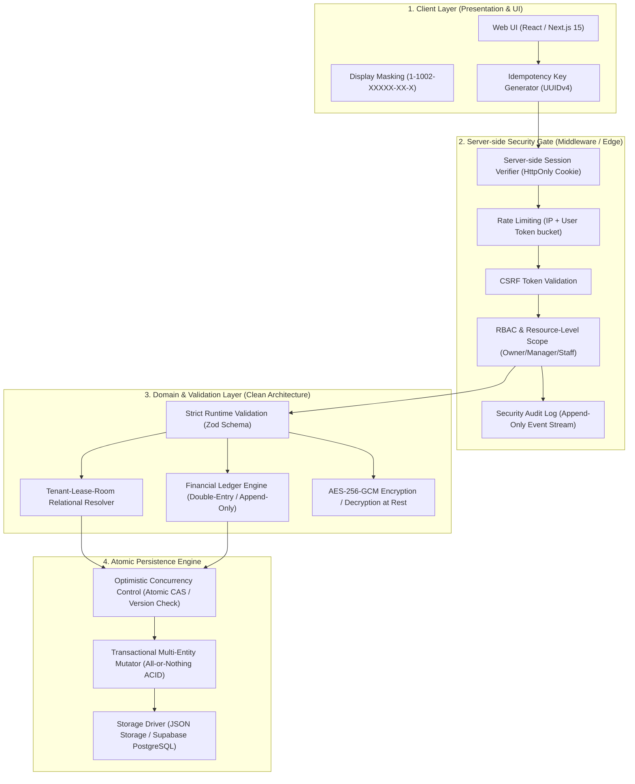
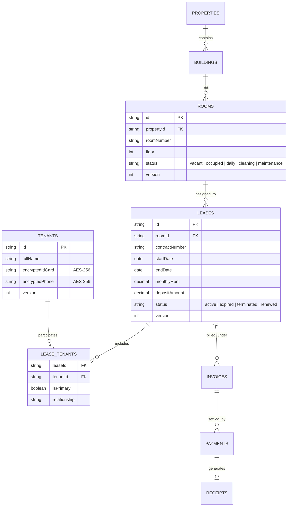
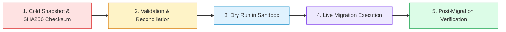

# 🏛️ แผนสถาปัตยกรรมและการปรับปรุงระบบฉบับแก้ไขสมบูรณ์
# (PAKDEE Enterprise Architecture Remediation Plan v2.0)

**สถานะเอกสาร:** รอการอนุมัติจากผู้ดูแลระบบ (Pending Administrator Approval - NO CODE MODIFIED)  
**ผู้ออกแบบ:** Senior Software Architect, Database Integrity Auditor & Lead Security Engineer  
**ที่ตั้งเอกสาร:** `D:\DESKTOP\Pakdee\docs\IMPLEMENTATION_PLAN.md`  
**อ้างอิง:** ข้อกำหนดการตรวจสอบและแก้ไขระบบความปลอดภัยและบูรณภาพข้อมูล (Audit Feedback & Remediation Standards)  
**วันที่ประกาศ:** 2 พฤศจิกายน 2026

---

## 1. บทนำและวัตถุประสงค์ (Executive Architecture Overview)

เอกสารฉบับนี้เป็นแผนสถาปัตยกรรมฉบับปรับปรุงแก้ไข (Revision 2.0) โดยยกเลิกแนวทางชั่วคราวทั้งหมด (เช่น Client Shared Secret, Two-way Sync, Masking แทน Encryption) และยกระดับระบบสู่ **Enterprise & Production SaaS Standards** เพื่อแก้ปัญหาความเสี่ยง 5 ด้านสำคัญ:

1. **API Security & Server-side RBAC:** เปลี่ยนเป็น Server-side Session (HttpOnly Signed Cookie / Secure JWT) พร้อม Role-Based Access Control และ Resource-Level Scoping
2. **Optimistic Concurrency Control (OCC):** ป้องกัน Race Condition และ Last-Write-Wins ด้วย Atomic Compare-and-Swap (CAS), Version Number, และ Idempotency Keys
3. **Single Source of Truth (SSOT) Tenant Architecture:** ถอด Embedded `Room.currentTenant` ออกอย่างเด็ดขาด เปลี่ยนเป็น Relational Triad: `Tenants` ↔ `Leases` ↔ `Rooms`
4. **Double-Entry Financial Payment Ledger:** นำระบบ Ledger ที่มีคุณสมบัติ Append-Only / Immutable พร้อมรองรับ Partial Payments, Allocation, Credit Overpayment, Reversal/Void, และ Official Receipts
5. **Multi-Layer Data Privacy & Encryption at Rest:** แยก Server-side Validation (Zod), AES-256-GCM Encryption, Masking, และ Log Redaction ออกจากกันตามมาตรฐาน PDPA / ISO 27001

> ⚠️ **คำมั่นสัญญาด้านความปลอดภัย:**  
> **ไม่มีการแก้ไข Source Code, Database Schema หรือข้อมูลจริงใดๆ ในขณะนี้** ระบบจะคงสถานะ Read-Only จนกว่าเอกสารฉบับนี้จะผ่านการอนุมัติอย่างเป็นทางการ

---

## 2. แผนผังสถาปัตยกรรมและการไหลของข้อมูลใหม่ (Target Architecture & Data Flow)



---

## 3. สถาปัตยกรรมความปลอดภัยและการควบคุมสิทธิ์ (Security Design & Server-side RBAC)

### 3.1 Server-side Session Authentication & CSRF
* **ห้าม Client Shared Secret:** ยกเลิกแนวคิดการส่ง Secret จากเบราว์เซอร์อย่างถาวร
* **กลไกการยืนยันตัวตน:**
  - สร้าง Session ฝั่ง Server จัดเก็บใน Secure Store (Redis / Encrypted File Session Store)
  - ส่งผ่านเบราว์เซอร์ด้วย **`HttpOnly`, `Secure`, `SameSite=Strict` Cookie** (`__Host-pakdee_session`)
  - คีย์เซสชันมีอายุจำกัด (Session TTL 12 ชั่วโมง) พร้อม Sliding Expiration เมื่อมีการใช้งานต่อเนื่อง
* **CSRF Protection:**
  - ติดตั้ง Double Submit Cookie Pattern หรือ Synchronizer Token ผ่าน Header `X-CSRF-Token` สำหรับทุกคำขอที่เป็น State-Mutating (`POST`, `PUT`, `DELETE`, `PATCH`)

### 3.2 Server-side Authorization & Resource-Level RBAC Matrix
ระบบตรวจสอบสิทธิ์ระดับ Server-side Controller โดยประเมิน 3 มิติ:
$$\text{Access Granted} \iff (\text{Role Has Permission}) \land (\text{User Assigned to PropertyId}) \land (\text{Resource Belongs to PropertyId})$$

| Role | Properties Scope | Rooms / Meters | Invoices / Payments | Financial Reports | System Settings |
| :--- | :---: | :---: | :---: | :---: | :---: |
| **Owner (Super Admin)** | All Branches | Full CRUD | Full CRUD + Void | Read + Export | Full Access |
| **Manager (Branch Admin)**| Assigned Branch | Full CRUD | Create / Receive / No Void | Read Only (No Export) | View Only |
| **Receptionist** | Assigned Branch | Read / Check-in | Read / Create / Receive | No Access | No Access |
| **Technician (ช่างซ่อม)**| Assigned Branch | Read Status / Repairs | No Access | No Access | No Access |
| **Housekeeper (แม่บ้าน)**| Assigned Branch | Read Rooms / Cleaning | No Access | No Access | No Access |

### 3.3 Security Audit Log & Rate Limiting
- **Rate Limiting:** จำกัดคำขอที่ Endpoint การเงินและบันทึกข้อมูลที่ 60 requests/minute ต่อ IP/Session (ป้องกัน Brute Force & DoS)
- **Security Audit Log:** บันทึก Event ลงตาราง `security_audit_logs` (User, Action, Resource, IP, Timestamp, UserAgent, Result) ห้ามแก้ไขหรือลบ

---

## 4. กลไกควบคุมการบันทึกข้อมูลพร้อมกัน (Optimistic Concurrency & Transactions)

### 4.1 Schema Versioning & Compare-and-Swap (CAS)
ทุก Entity ในระบบจะมีฟิลด์อภิมหาข้อมูล (Metadata):
```typescript
interface EntityMeta {
  version: number;        // Monotonically increasing counter (1, 2, 3...)
  createdAt: string;     // ISO 8601 UTC
  updatedAt: string;     // ISO 8601 UTC
  updatedBy: string;     // User ID of modifier
}
```

### 4.2 ขั้นตอนการตรวจสอบและกักกันความขัดแย้ง (OCC Flow)
1. **Client Fetch:** Client อ่านข้อมูล Room A (version = 4)
2. **Client Mutation:** Client ส่งคำขออัปเดต Room A พร้อมแนบ `expectedVersion = 4`
3. **Atomic Compare-and-Swap (CAS):**
   ```typescript
   if (currentEntity.version !== request.expectedVersion) {
     return response.status(409).json({
       error: "CONFLICT_VERSION_MISMATCH",
       message: "ข้อมูลถูกแก้ไขโดยผู้ใช้งานท่านอื่นแล้ว กรุณาโหลดข้อมูลใหม่",
       currentVersion: currentEntity.version,
       serverState: currentEntity,
     });
   }
   currentEntity.version += 1;
   ```
4. **Idempotency Key Safeguard:** ทุกคำขอด้านการเงิน (Payments / Invoices / Contracts) ต้องส่ง Header `Idempotency-Key: <UUIDv4>` ป้องกันการดับเบิ้ลคลิก หรือเน็ตเวิร์ก Retry ซ้ำซ้อน

---

## 5. สถาปัตยกรรมข้อมูลผู้เช่าและสัญญาฉบับสมบูรณ์ (Single Source of Truth Tenant Architecture)

### 5.1 การยกเลิก Embedded Tenant ใน Room
* **โครงสร้างเดิม:** `Room.currentTenant` เป็น Object ซ้ำซ้อน $\rightarrow$ **ยกเลิกถาวร**
* **โครงสร้างใหม่:** `Room` เก็บเฉพาะสถานะทางกายภาพของห้องพัก ส่วนความสัมพันธ์ของผู้เช่าถูกขับเคลื่อนผ่านตาราง **`leases` (สัญญาเช่า)**



### 5.2 การรองรับกรณีทางธุรกิจที่ซับซ้อน (Edge Cases Matrix)

| สถานการณ์ | วิธีจัดการตามสถาปัตยกรรมใหม่ | สถานะข้อมูลในระบบ |
| :--- | :--- | :--- |
| **1. เพิ่มผู้เช่าใหม่** | 1. สร้าง Record ใน `tenants`<br>2. สร้าง Record ใน `leases` (status: active)<br>3. ผูกใน `lease_tenants`<br>4. อัปเดต `rooms.status = "occupied"` | ความสัมพันธ์สมบูรณ์แบบ Transaction |
| **2. ผู้เช่าย้ายห้อง** | 1. อัปเดต Lease เดิม: `status = "terminated"`, `terminationReason = "room_transfer"`<br>2. อัปเดตห้องเดิม: `status = "cleaning"`<br>3. สร้าง Lease ใหม่สำหรับห้องใหม่<br>4. ยกยอดเงินประกันและหนี้ค้างข้ามสัญญา | สัญญาเดิมถูกเก็บเป็นประวัติ ไม่สูญหาย |
| **3. สัญญาหมดอายุ / ต่อสัญญา** | 1. สัญญาเดิมเปลี่ยนเป็น `status = "renewed"`<br>2. สร้างสัญญาใหม่ที่มี `supersedesLeaseId` อ้างอิงสัญญาเดิม | สืบย้อนประวัติสัญญาได้ต่อเนื่อง |
| **4. ผู้เช่าหลายคนในห้องเดียว** | ตาราง `lease_tenants` รองรับ Multiple Tenants โดยกำหนด `isPrimary = true` สำหรับผู้ทำสัญญาหลัก และ `isPrimary = false` สำหรับผู้อาศัยร่วม | บันทึกเลขบัตรผู้อาศัยร่วมได้ทุกคน |
| **5. ผู้เช่าคนเดิม เช่าหลายช่วงเวลา** | บัญชี `Tenant` เดิมคงอยู่ แต่มี `Lease` หลายฉบับที่มีช่วงเวลา (`startDate` - `endDate`) แตกต่างกัน | ค้นหาประวัติย้อนหลังของผู้เช่าคนเดิมได้ครบ |

---

## 6. สถาปัตยกรรมระบบบัญชีและการเงินแบบสมุดรายวันแยกประเภท (Financial Ledger & Audit Trail)

### 6.1 กฎเหล็กทางการเงิน (Immutable Financial Laws)
1. **Append-Only / No Hard Delete:** ห้ามลบหรือแก้ไข Record การเงินย้อนหลังเด็ดขาด
2. **Reversal & Void Process:** หากพนักงานบันทึกเงินผิด ต้องสร้างรายการ **Reversal Transaction** ที่มีเครื่องหมายตรงกันข้าม เพื่อหักล้างยอดเดิม พร้อมระบุ `voidReason` และ `authorizedBy`
3. **Exact Allocation Formula:**
   $$\text{Invoice.RemainingAmount} = \text{Invoice.TotalAmount} - \sum (\text{AllocatedPayments}) + \sum (\text{ReversedPayments})$$

### 6.2 Data Schema สำหรับ Payment Ledger & Allocation
```typescript
export interface Payment {
  id: string;                      // PK: pay-UUID
  paymentNumber: string;           // PMT-YYYYMM-XXXX
  propertyId: string;
  invoiceId: string;
  tenantId: string;
  amount: number;                  // ยอดเงินที่รับจริง
  paymentMethod: "transfer" | "cash" | "promptpay" | "credit_card";
  paidAt: string;                  // ISO UTC
  receivedBy: string;              // User ID
  status: "completed" | "voided" | "reversed";
  idempotencyKey: string;          // ป้องกันยิงซ้ำ
  slipUrl?: string;
  allocations: PaymentAllocation[]; // การจัดสรรยอด
  version: number;
}

export interface PaymentAllocation {
  invoiceItemId: string;           // ผูกกับรายการในบิล (ค่าเช่า, น้ำ, ไฟ)
  itemType: "rent" | "water" | "electric" | "service" | "penalty";
  allocatedAmount: number;
}

export interface Receipt {
  id: string;                      // PK: rec-UUID
  receiptNumber: string;           // REC-YYYYMM-XXXX (Running Number)
  paymentId: string;               // 1-to-1 กับ Payment
  invoiceId: string;
  issuedAt: string;
  issuedBy: string;
  pdfUrl?: string;
}

export interface TenantCreditBalance {
  tenantId: string;
  availableCredit: number;         // ยอดเงินที่จ่ายเกินมา สะสมไว้หักบิลถัดไป
  history: {
    sourcePaymentId: string;
    amount: number;
    usedInInvoiceId?: string;
    createdAt: string;
  }[];
}
```

---

## 7. สถาปัตยกรรมการปกป้องข้อมูลส่วนบุคคล (Privacy, Validation & Encryption at Rest)

### 7.1 การแบ่งแยกชั้นการจัดการข้อมูลความปลอดภัย
```
┌─────────────────────────────────────────────────────────────┐
│ 1. Boundary Validation (Zod Schema at Server Controller)    │
│    - ตรวจสอบรูปแบบ Regex เลขบัตร 13 หลัก, Checksum อัลกอริทึม  │
├─────────────────────────────────────────────────────────────┤
│ 2. Encryption at Rest (CryptoService)                       │
│    - อัลกอริทึม: AES-256-GCM (Ciphertext + IV + Auth Tag)    │
│    - เข้ารหัสเฉพาะฟิลด์ PII: idCard, phone, emergencyPhone   │
├─────────────────────────────────────────────────────────────┤
│ 3. Storage Layer (Encrypted Storage)                        │
│    - ฐานข้อมูลบันทึกเป็น Ciphertext (ป้องกันข้อมูลหลุดหาก DB รั่ว) │
├─────────────────────────────────────────────────────────────┤
│ 4. Presentation Layer (Display Masking)                     │
│    - แปลงข้อมูลฝั่ง Frontend: "1-1002-XXXXX-XX-X"            │
│    - อนุญาตให้กดดูตัวเต็มเฉพาะ Role Owner ที่มีรหัสยืนยัน      │
├─────────────────────────────────────────────────────────────┤
│ 5. Audit & Log Redaction                                    │
│    - Middleware Redaction กรองข้อความ PII ออกจาก Console & Logs │
└─────────────────────────────────────────────────────────────┘
```

---

## 8. ยุทธศาสตร์การย้ายข้อมูลและการกู้คืน (Migration Strategy & Dry Run Plan)

### 8.1 ลำดับขั้นการย้ายข้อมูล (Migration Pipeline)



### 8.2 ตารางเปรียบเทียบการแปลงข้อมูล (Data Mapping & Reconciliation Matrix)

| Legacy Data Source | Target Relational Entity | Mapping & Transformation Logic | การตรวจสอบความสมบูรณ์ |
| :--- | :--- | :--- | :--- |
| `rooms[].currentTenant` | `tenants` & `leases` & `lease_tenants` | สกัด Object ผู้เช่าที่ฝังอยู่ ออกมาสร้างเป็น Record ผู้เช่าจริง และสร้าง Active Lease ผูกห้อง | ยอดรวมผู้เช่าก่อนและหลังต้องเท่าเดิม 100% |
| `invoices[].status == 'paid'` | `payments` & `receipts` | สร้าง Legacy Payment Record ตามยอด `totalAmount` เพื่อให้มียอด Ledger อ้างอิง | ผลรวมยอดเงินใน Ledger ต้องตรงกับยอดในบิลเดิม |
| `rooms[].status` | `rooms.status` | ถอด `currentTenant` ออก คงเหลือเฉพาะ `status: vacant \| occupied \| daily \| cleaning` | จำนวนห้องทั้งหมด = 24 ห้องเท่าเดิม |
| `tenants[].idCard` | `tenants.encryptedIdCard` | เข้ารหัสด้วยคีย์ AES-256 ประจำ Environment | ถอดรหัสเปรียบเทียบค่าตรงกัน 100% |

---

## 9. การประเมินความเสี่ยงและมาตรการควบคุม (Risk Assessment)

| ความเสี่ยง (Risk Event) | ความน่าจะเป็น | ผลกระทบ | มาตรการควบคุมและป้องกัน (Mitigation Control) |
| :--- | :---: | :---: | :--- |
| **1. ข้อมูลสูญหายระหว่างแปลงโครงสร้าง** | ต่ำ | วิกฤต | ทำ Snapshot ทั้งโฟลเดอร์ และคำนวณ Checksum ก่อนเริ่ม หากมี Mismatch ให้ยกเลิกทันที |
| **2. Client เดิมแคชโครงสร้างเก่าไว้** | ปานกลาง | ปานกลาง | เปลี่ยนชื่อ Storage Key จาก `pakdee_dev_*` เป็น `pakdee_v2_*` เพื่อตัดขาด Cache เก่า |
| **3. ประสิทธิภาพการเข้ารหัส AES-256** | ต่ำ | ต่ำ | เข้ารหัสเฉพาะฟิลด์ PII (ไม่เข้ารหัสทั้ง Object) ใช้ Node.js Native `crypto` ซึ่งเร็วระดับ Microsecond |
| **4. เกิด Concurrency Conflict ถี่เกินไป** | ต่ำ | ต่ำ | ออกแบบ Client Auto-Retry พร้อม Exponential Backoff ในระดับ Presentation Service |

---

## 10. แผนการทดสอบและเกณฑ์การยอมรับ (Test Plan & Acceptance Criteria)

### 🔹 Test Matrix 1: Concurrency 2 Machines Test
- **วิธีทดสอบ:** รันสคริปต์จำลอง Browser 2 Sessions ผ่าน Headless Chrome ส่งคำขอแก้สถานะห้อง 101 พร้อมกัน
- **เกณฑ์ยอมรับ:** Session แรกสำเร็จ (200 OK, version=2), Session ที่สองถูกปฏิเสธด้วย `409 Conflict` และ Client โหลด State ใหม่มาแสดงผล โดยข้อมูลไม่ถูก Overwrite

### 🔹 Test Matrix 2: Financial Partial Payment & Allocation
- **วิธีทดสอบ:** บิลค่าเช่า 5,000 บาท (ค่าห้อง 4,000 + ไฟ 1,000) ทำการรับเงินก้อนแรก 3,000 บาท
- **เกณฑ์ยอมรับ:** 
  - สร้าง `Payment` ที่ 1 ยอด 3,000 บาท
  - ยอดคงเหลือในบิลแสดง 2,000 บาท สถานะเป็น `partial`
  - ทำการรับเงินก้อนที่สอง 2,000 บาท สถานะบิลเปลี่ยนเป็น `paid` ยอดคงเหลือเป็น 0.00 บาท ตรวจสอบย้อนกลับจาก Ledger ได้ตรง 100%

### 🔹 Test Matrix 3: Unauthorized API Tampering Test
- **วิธีทดสอบ:** ยิง cURL POST เข้าสู่ `/api/db` โดยไม่มี Session Cookie หรือ CSRF Token
- **เกณฑ์ยอมรับ:** Server ตอบกลับด้วย `401 Unauthorized` หรือ `403 Forbidden` ทันที และบันทึกเหตุการณ์ลง `security_audit_logs`

---

## 11. รายการไฟล์ที่คาดว่าจะเปลี่ยนแปลง (File Change Manifest)

| ไฟล์เป้าหมาย (File Path) | ประเภทการเปลี่ยนแปลง | วัตถุประสงค์ของการเปลี่ยนแปลง |
| :--- | :---: | :--- |
| `src/types/dormitory.ts` | ปรับปรุงโครงสร้าง Type | เพิ่ม `Payment`, `PaymentAllocation`, `Receipt`, `EntityMeta`, ปรับ `Room` และ `Tenant` |
| `src/lib/crypto.service.ts` | **สร้างไฟล์ใหม่** | โมดูลเข้ารหัส/ถอดรหัส AES-256-GCM สำหรับข้อมูล PII |
| `src/lib/session.service.ts` | **สร้างไฟล์ใหม่** | ระบบตรวจสอบ Server-side Session, CSRF, และ Role Verification |
| `src/lib/database.service.ts` | ปรับปรุง Logic ภายใน | ถอด Two-way sync, เพิ่ม Relational Resolvers, OCC CAS Logic, และ Payment Engine |
| `src/app/api/db/route.ts` | ปรับปรุง Security Gate | ติดตั้ง Session Gate, CSRF Check, RBAC Verification, และ Rate Limiter |
| `scripts/migrate_v1_to_v2.js` | **สร้างสคริปต์ใหม่** | สคริปต์ตรวจสอบความถูกต้อง, Snapshot, และทำ Dry Run แปลงข้อมูล |

---

## 12. แผนการย้อนกลับฉุกเฉิน (Rollback Plan)

หากเกิดเหตุขัดข้องประการใดในขั้นตอน Migration หรือการทดสอบหลังปรับปรุง:
1. **ขั้นตอนที่ 1:** รันคำสั่งกู้คืน Snapshot อัตโนมัติ:
   ```bash
   node scripts/rollback_to_snapshot.js
   ```
2. **ขั้นตอนที่ 2:** คืนค่าไฟล์ `data/db_port3000.json` และไฟล์ Source Code จาก Git Commit ล่าสุด
3. **ขั้นตอนที่ 3:** ยืนยันสถานะระบบด้วย `scripts/verify_sheets.js` และ E2E Smoke Test เพื่อให้ระบบกลับสู่สภาวะปกติภายในเวลาไม่เกิน 3 นาที

---

## 13. ตารางสรุปผลกระทบต่อฟีเจอร์เดิม (Legacy Feature Impact Analysis)

| ฟีเจอร์เดิม | มีผลกระทบหรือไม่ | รายละเอียดและพฤติกรรมใหม่ |
| :--- | :---: | :--- |
| **ผังสถานะห้องพัก (`/rooms`)** | ไม่มีผลเสีย (UX ดีขึ้น) | ผังห้องแสดงสีเหมือนเดิมทุกประการ แต่โหลดเร็วขึ้นเพราะไม่ต้องแบก Embedded Tenant Data ขนาดใหญ่ |
| **การจองรายวัน (`/daily`)** | ไม่มีผลเสีย | หน้าตาเหมือนเดิม แต่ข้อมูลแขกถูกจัดเก็บเข้าตาราง `tenants` และ `leases` อย่างถูกต้องตามหลัก Relational |
| **การออกบิลและจดมิเตอร์ (`/invoices`)** | ปรับปรุงให้ดีขึ้น | สามารถรับชำระบางส่วนได้แล้ว และสามารถพิมพ์ใบเสร็จรับเงินจริงที่มีเลขที่ใบเสร็จเป็นทางการได้ |
| **ระบบทำความสะอาด (`/cleaning`)** | ไม่มีผลเสีย | สถานะคงเดิม ซิงค์ผ่าน State Machine ป้องกันข้อมูลเด้งกลับ |
| **ระบบส่งออกบัญชี (`/reports`)** | ปรับปรุงให้ปลอดภัยขึ้น | สงวนสิทธิ์การ Export เฉพาะผู้มีบทบาท Owner ป้องกันข้อมูลรั่วไหล |

---

## 14. หนังสือขออนุมัติอย่างเป็นทางการ (Official Sign-Off Request)

แผนสถาปัตยกรรมฉบับนี้ ได้รับการออกแบบตามหลักวิศวกรรมซอฟต์แวร์ขั้นสูงเพื่อความมั่นคงปลอดภัยและบูรณภาพข้อมูลสูงสุด

> 🔔 **ขณะนี้ Source Code และ Database ทั้งหมด ยังคงถูกล็อกไว้ ไม่มีการแก้ไขใดๆ**  
> หากท่านพิจารณาเอกสารฉบับนี้และเห็นชอบในแนวทาง กรุณาตอบกลับว่า:  
> **"อนุมัติตามแผนสถาปัตยกรรมฉบับปรับปรุง v2.0"**  
> เพื่อให้ทีมงานเริ่มขั้นตอนที่ 1 (Pre-Migration Snapshot & Dry Run) ต่อไปครับ
