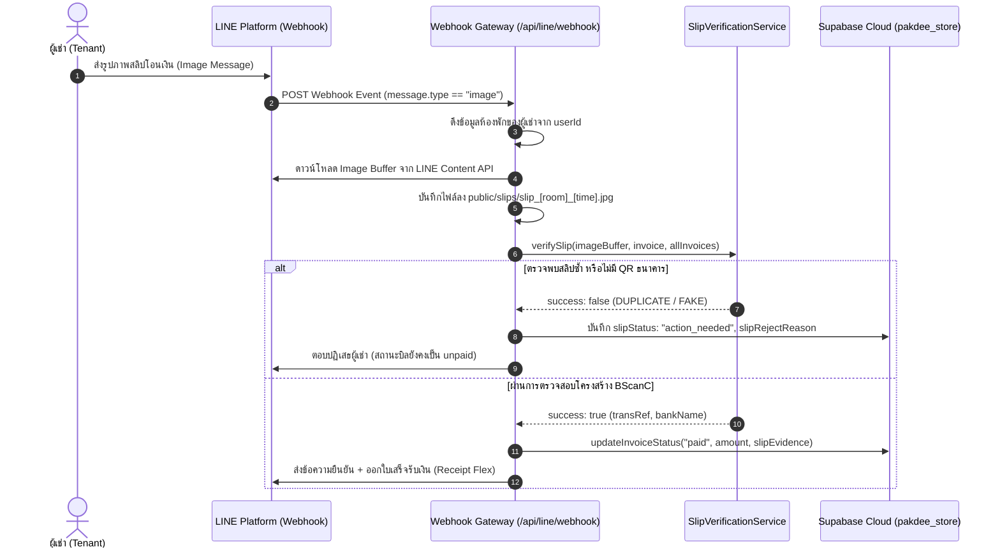

# รายงานผลการตรวจสอบระบบ LINE BOT และการตรวจสอบสลิปโอนเงิน (PAKDEE AUDIT REPORT)
**โครงการ:** ระบบบริหารจัดการหอพักและอพาร์ตเมนต์ PAKDEE (Dormitory Management System)  
**ประเภทงาน:** INVESTIGATION & ARCHITECTURAL AUDIT ONLY (ตรวจสอบเชิงลึกโดยไม่มีการดัดแปลงแก้ไขระบบ)  
**วันที่ตรวจสอบ:** 6 พฤศจิกายน 2026  
**ผู้ตรวจสอบ:** QS Smart Development Team (Defensive Clean Architecture & Financial Systems Audit Group)  
**ฐานข้อมูลหลัก (Single Source of Truth):** Supabase Cloud PostgreSQL (`pakdee_store`)  
**สถานะการตรวจสอบ:** เสร็จสิ้นสมบูรณ์ (Completed)  

---

## สารบัญเอกสาร (Table of Contents)
1. [PART 1 — การระบุตัวตนผู้เช่าและการสื่อสาร (Tenant Identification & Communication Audit)](#part-1--tenant-identification--communication)
2. [PART 2 — ผังการสืบย้อนแหล่งที่มาของข้อมูลข้อความ (Message Data Source & Traceability Mapping)](#part-2--message-data-source--traceability-mapping)
3. [PART 3 — การประเมินเทคโนโลยีการตรวจสอบสลิปโอนเงิน (Payment Slip Verification Technology Audit)](#part-3--payment-slip-verification-technology-audit)
4. [PART 4 — ขั้นตอนการเงินและการควบคุมความเสี่ยง (Payment Workflow & Financial Safeguards)](#part-4--payment-workflow--financial-safeguards)
5. [PART 5 — การตรวจสอบความมั่นคงปลอดภัยและความเป็นส่วนตัว (Security & Privacy Audit)](#part-5--security--privacy-audit)
6. [PART 6 — ตารางหลักฐานผลการทดสอบจริง (QA Test Evidence Matrix)](#part-6--qa-test-evidence-matrix)
7. [PART 7 — สรุปความเสี่ยงทางการเงินและข้อเสนอแนะเชิงป้องกัน (Remaining Risks & Recommendations)](#part-7--remaining-risks--recommendations)
8. [คำตอบชี้ขาด 9 ประการ (Final Answers to Mandatory Questions)](#final-answers-to-mandatory-questions)

---

# PART 1 — TENANT IDENTIFICATION & COMMUNICATION

### 1.1 สถาปัตยกรรมการระบุตัวตนในปัจจุบัน (Current Identity Model)
จากการตรวจสอบโค้ดใน [`src/app/api/line/webhook/route.ts`](file:///d:/DESKTOP/Pakdee/src/app/api/line/webhook/route.ts) และ [`src/lib/database.service.ts`](file:///d:/DESKTOP/Pakdee/src/lib/database.service.ts) พบว่า:
* ระบบ **ไม่ได้ใช้ `tenantId` หรือเบอร์โทรศัพท์เป็น Primary Identifier** ในการค้นหาตั้งแต่แรกเข้า
* ระบบใช้ **"เลขห้องพัก (`roomNumber` / `canonicalRoomNumber`)"** เป็น Anchor หลัก (Single Source of Truth Anchor)
* ข้อมูลความสัมพันธ์ถูกเก็บไว้ใน Supabase Cloud ตาราง `pakdee_store` ใน 2 คีย์หลัก:
  1. `pakdee_dev_rooms` (ฟิลด์ `room.currentTenant.lineUserId`)
  2. `pakdee_dev_tenants` (ฟิลด์ `tenant.lineUserId` และ `tenant.roomNumber`)

### 1.2 การประเมินทั้ง 8 สถานการณ์ของผู้เช่า (8 Tenant Scenarios Audit)

| ลำดับสถานการณ์ | การระบุตัวตน (Identification) | การได้มาและการผูก `lineUserId` | เอนทิตีที่เก็บในฐานข้อมูล | วิธีป้องกันการส่งผิดคน | สถานะผลการตรวจ |
| :--- | :--- | :--- | :--- | :--- | :--- |
| **1. ผู้เช่ารายเดือนเข้าใหม่ (New Monthly)** | ผู้เช่าพิมพ์เลขห้อง (เช่น `101`, `A101`) ระบบเทียบกับ `ROOMS` ผ่าน [`DatabaseService.findMatchingRoom`](file:///d:/DESKTOP/Pakdee/src/lib/database.service.ts#L1073) | ดึง `event.source.userId` จาก LINE Webhook แล้วผูกผ่าน `bindTenantLineUser()` | บันทึกใน `pakdee_dev_rooms` และ `pakdee_dev_tenants` | ตรวจสอบว่ามีห้องอยู่จริงในผังห้อง | **VERIFIED** |
| **2. ผู้เช่ารายเดือนเดิม (Existing Monthly)** | เมื่อผู้เช่าทักข้อความ ระบบค้นหาผ่าน `getTenantByLineUser(userId)` | มี `lineUserId` ผูกไว้อยู่แล้วในฐานข้อมูล | ค้นหาจาก `pakdee_dev_rooms` และ `pakdee_dev_tenants` | ดึงเฉพาะบิลที่ `roomNumber` ตรงกับห้องที่ผูก | **VERIFIED** |
| **3. ผู้พักรายวันปัจจุบัน (Daily Tenant)** | ค้นหาผ่าน `daily_bookings` ตาม `roomNumber` และ `guestPhone` | ❌ **ไม่มี Flow ผูก LINE สำหรับแขกรายวัน** | `pakdee_dev_daily_bookings` ไม่มีฟิลด์ `lineUserId` | แขกรายวันไม่ได้รับข้อความส่วนตัวผ่าน LINE | **PARTIALLY VERIFIED** |
| **4. การจองห้องรายวันใหม่ (New Daily Booking)** | รับข้อมูลผ่านหน้า UI `/daily` หรือ Modal | ❌ **ไม่ได้รับ `lineUserId`** แขกไม่ได้แอดไลน์ | บันทึกเฉพาะชื่อ, เบอร์โทร ใน `daily_bookings` | ไม่มีการส่งข้อความยืนยันการจองผ่าน LINE | **NOT APPLICABLE** |
| **5. ผู้เช่าย้ายห้อง (Room Change)** | ผู้เช่าพิมพ์เลขห้องใหม่ (เช่น `102`) | ทับ `lineUserId` เดิมในห้องใหม่ และปลด `lineUserId` จากห้องเดิม (บรรทัด 1090-1097) | อัปเดตทั้งใน `ROOMS` และ `TENANTS` | ฟังก์ชันเคลียร์ `lineUserId` เดิมทิ้งทันทีที่ผูกห้องใหม่ | **VERIFIED** |
| **6. ผู้เช่าสิ้นสุดสัญญา (Lease Termination / Checkout)** | แอดมินกดเช็คเอาท์ที่หน้า `/checkout` หรือปรับสถานะเป็น `vacant` | ⚠️ **ไม่ได้ลบ `lineUserId` ออกจากผู้เช่าประวัติเก่า** แต่ลบ `currentTenant` ออกจากห้อง | `room.currentTenant` กลายเป็น `undefined` | เมื่อผู้เช่าทักมา จะไม่พบห้องที่พักอาศัยอยู่ | **PARTIALLY VERIFIED** |
| **7. ผู้เช่าที่ค้างชำระ (Overdue Invoices)** | ค้นหาจากบิลที่ `status !== 'paid'` ของห้องที่ผูกไว้ | ใช้ `lineUserId` ที่ผูกกับห้อง ส่งบิลค้างชำระทันทีที่พิมพ์ "ขอบิล" หรือตอนผูกห้องสำเร็จ | `pakdee_dev_invoices` และ `pakdee_dev_rooms` | ส่งเฉพาะบิลของห้องตนเอง | **VERIFIED** |
| **8. ผู้เช่าที่มีหลายห้อง/หลายสาขา (Multi-Room / Multi-Property)** | ระบบออกแบบเป็น **1 LINE User ID ต่อ 1 ห้อง** | หากผู้เช่าคนเดิมพิมพ์ผูกอีกห้อง ระบบจะย้ายการผูกไปยังห้องล่าสุด | ไม่รองรับ 1 LINE ID ดูพร้อมกันหลายห้อง | **ไม่รองรับ Multi-Room ใน Session เดียว** | **FAILED (Unimplemented)** |

### 1.3 หลักฐานโค้ดจริง (Code Evidence)
```typescript
// File: src/lib/database.service.ts (บรรทัด 1072-1148)
const roomMatch = this.findMatchingRoom(allRooms, cleanRoom, propId);
if (!roomMatch) return null;

// ปลดการผูกของผู้ใช้รายอื่นที่เคยผูกกับห้องนี้
const updatedTenants = allTenants.map((t) => {
  if (t.roomNumber === canonicalRoomNumber && t.lineUserId !== lineUserId) {
    return { ...t, lineUserId: undefined };
  }
  return t;
});

// อัปเดตสถานะห้องใน ROOMS (Single Source of Truth)
const updatedRooms = allRooms.map((r) => {
  if (r.id === roomMatch.id) {
    return {
      ...r,
      currentTenant: { ...(r.currentTenant || {}), lineUserId, roomNumber: canonicalRoomNumber }
    };
  }
  return r;
});
```

---

# PART 2 — MESSAGE DATA SOURCE & TRACEABILITY MAPPING

ตารางสืบย้อนแหล่งที่มาของข้อมูล (Data Mapping Matrix) ทั้ง 13 ประเภทข้อความ:

| ลำดับ | ประเภทข้อความ (Message Type) | ผู้รับ (Recipient) | หน้าจอต้นทาง (UI Page) | Entity / Table ใน Supabase | ฟิลด์ข้อมูลต้นทาง (Source Fields) | วิธีการดึงข้อมูล (Method) | การคำนวณสด (Transformation) | LINE Template ที่ใช้ | สถานะการทำงานจริง |
| :---: | :--- | :--- | :--- | :--- | :--- | :--- | :--- | :--- | :---: |
| 1 | **แจ้งเตือนต้อนรับ (Welcome)** | ผู้ใช้ที่กด Follow | หน้า LINE OA | `pakdee_dev_branch_settings` | `branchName` | `getBranchSettings()` | ข้อความต้อนรับและปุ่มนำทาง | `buildWelcomeFlexMessage` | **VERIFIED** |
| 2 | **ยืนยันการผูกห้อง (Room Linked)** | ผู้เช่าที่พิมพ์เลขห้อง | หน้า `/rooms` | `pakdee_dev_rooms` | `roomNumber`, `currentTenant.fullName` | `bindTenantLineUser()` | จับคู่ Regex เลขห้อง | Text Message | **VERIFIED** |
| 3 | **บิลแจ้งหนี้รายเดือน (Monthly Invoice)** | ผู้เช่าห้องนั้นๆ | หน้า `/invoices` | `pakdee_dev_invoices`, `branch_settings` | `items[]`, `totalAmount`, `dueDate`, `promptpayNumber` | `getInvoices(activePropId)` | แยกแจงค่าน้ำ ค่าไฟ ค่าห้อง + สร้าง Dynamic QR | `buildInvoiceFlexMessage` | **VERIFIED** |
| 4 | **ค่าน้ำประปา (Water Charge)** | รวมในบิล | หน้า `/meter` | `invoices.items` | `units`, `rate`, `amount`, `meterPrev`, `meterCurr` | อ่านจาก Array `items` ในบิล | `units × waterRate` | อยู่ในการ์ดบิลแจ้งหนี้ | **VERIFIED** |
| 5 | **ค่าไฟฟ้า (Electricity Charge)** | รวมในบิล | หน้า `/meter` | `invoices.items` | `units`, `rate`, `amount`, `meterPrev`, `meterCurr` | อ่านจาก Array `items` ในบิล | `units × electricRate` | อยู่ในการ์ดบิลแจ้งหนี้ | **VERIFIED** |
| 6 | **แจ้งเตือนยอดค้างชำระ (Overdue)** | ผู้เช่าที่พิมพ์ "ขอบิล" | หน้า `/invoices` | `pakdee_dev_invoices` | `totalAmount`, `status: "unpaid"\|"overdue"` | `invoices.find(status !== 'paid')` | แสดงยอดหนี้คงค้าง | `buildInvoiceFlexMessage` | **VERIFIED** |
| 7 | **ยืนยันการตรวจสลิป (Slip Verified)** | ผู้เช่าที่ส่งรูปสลิป | หน้า `/slips` | ผลตรวจสลิป + `invoices` | `transRef`, `bankName`, `amount` | `verifySlip()` | สรุปยอดโอนและธนาคาร | Text Message | **VERIFIED** |
| 8 | **ใบเสร็จรับเงิน (Digital Receipt)** | ผู้เช่าที่สลิปผ่าน | หน้า `/receipts` | `invoices` | `invoiceNumber`, `totalAmount`, `paidAt` | ออกเลข `REC-YYYYMM-ROOM` | มาร์กบิลเป็น `paid` | `buildReceiptFlexMessage` | **VERIFIED** |
| 9 | **เปิดใบแจ้งซ่อม (Repair Ticket)** | ผู้เช่าที่พิมพ์แจ้งซ่อม | หน้า `/repairs` | `pakdee_dev_repairs` | `id`, `title`, `category`, `createdAt` | `addRepair()` | วิเคราะห์หมวดหมู่ (แอร์/น้ำ/ไฟ) | `buildRepairTicketFlexMessage` | **VERIFIED** |
| 10 | **ประกาศบรอดแคสต์ (Broadcast)** | ทุกคน / เฉพาะชั้น / เฉพาะห้อง | หน้า `/broadcast` | `pakdee_dev_broadcasts` | `title`, `message`, `template`, `targetType` | Form Submit `/api/line/broadcast` | Render Flex ประกาศ | `buildBroadcastFlexMessage` | **VERIFIED** |
| 11 | **เตือนวันครบกำหนดชำระ (Due Date)** | ผู้เช่า | - | - | - | - | ❌ ยังไม่มี Cron Job อัตโนมัติ | - | **NOT IMPLEMENTED** |
| 12 | **ยืนยันการจองรายวัน (Booking Confirm)** | แขกรายวัน | หน้า `/daily` | `daily_bookings` | - | - | ❌ ไม่มีการส่งเข้า LINE แขก | - | **NOT IMPLEMENTED** |
| 13 | **แจ้งเตือนสัญญาหมดอายุ (Lease Expiry)** | ผู้เช่ารายเดือน | หน้า `/contracts` | `contracts` | - | - | ❌ ยังไม่มีแจ้งเตือนผ่านบอท | - | **NOT IMPLEMENTED** |

---

# PART 3 — PAYMENT SLIP VERIFICATION TECHNOLOGY AUDIT

### 3.1 การประเมิน 4 ระดับของการตรวจสอบทางการเงิน (Financial Verification Hierarchy)

```
[ระดับ D] Payment Confirmation (อนุมัติสร้างรายการชำระเงินจริง)
   ▲        ├── รองรับ: ระบบเปลี่ยนสถานะบิลเป็น 'paid' ใน Database
   │
[ระดับ C] Transaction Verification (ตรวจยอดเงินเข้าบัญชีจริงกับธนาคาร)
   │        └── ❌ ไม่รองรับ: ยังไม่ได้ต่อ Open Banking API / SlipOK / EasySlip
   │
[ระดับ B] Data Consistency Check (แกะ BScanC QR Code + SHA-256 Hash Deduplication)
   │        └── ✅ รองรับ 100%: แกะรหัสธนาคาร, Ref ธุรกรรม และตรวจสลิปซ้ำ
   │
[ระดับ A] Image Reading (อ่านข้อมูลพิกเซลของภาพ)
            └── ✅ รองรับ 100%: ใช้ jpeg-js, pngjs และ jsQR ถอดรหัสพิกเซล
```

### 3.2 รายละเอียดเทคโนโลยีที่ใช้งานจริงในระบบ (Technical Stack)
1. **QR Code Matrix Scanning:**
   * ไลบรารี: `jsqr` (v1.4.0), `jpeg-js` (v0.4.4), `pngjs` (v7.0.0)
   * ตำแหน่งโค้ด: [`src/lib/slip-verification.ts`](file:///d:/DESKTOP/Pakdee/src/lib/slip-verification.ts#L97-L143) ฟังก์ชัน `extractQrFromImage()`
   * การทำงาน: แปลงไฟล์รูปภาพเป็น Raw RGBA Clamped Array สแกนทั้งภาพ หากไม่พบจะตัดครึ่งล่าง (Cropped Y 35%) ซึ่งเป็นตำแหน่งสลิปธนาคารไทย
2. **Thai Banking BScanC Decoder:**
   * ตำแหน่งโค้ด: [`src/lib/slip-verification.ts`](file:///d:/DESKTOP/Pakdee/src/lib/slip-verification.ts#L148-L240) ฟังก์ชัน `parseBScanC()`
   * การทำงาน: ถอดรหัส Tag-Length-Value (TLV) ดึง Subtag `01` (รหัสธนาคาร 12 สถาบัน เช่น 004 กสิกร, 025 กรุงศรี, 014 ไทยพาณิชย์) และ Subtag `02` (Transaction Reference)
3. **Anti-Duplicate Slip Engine (ระบบป้องกันสลิปซ้ำ 2 ชั้น):**
   * ชั้นที่ 1: `computeSlipHash(imageBuffer)` ใช้ SHA-256 Fingerprint ตรวจจับภาพที่ส่งซ้ำ 100%
   * ชั้นที่ 2: ตรวจสอบ `slipTransRef` เทียบกับประวัติบิลทั้งหมดในระบบ (`allInvoices`)
4. **Zero Float Financial Math:**
   * แปลงยอดเงินเป็นจำนวนเต็มสตางค์ (`Math.round(amount * 100)`) ก่อนเปรียบเทียบ

### 3.3 ข้อจำกัดวิกฤตและจุดโหว่ทางการเงินที่พบ (Critical Financial Finding)
> [!WARNING]
> **การประเมินยอดเงินในสลิป (Amount Verification Limitation):**
> โครงสร้างมาตรฐาน BScanC Mini QR บนสลิปของธนาคารไทยหลายแห่ง **ไม่ได้ฝังยอดเงินลงในเนื้อ QR Payload** (ใน QR มีเพียงรหัสอ้างอิงและรหัสธนาคาร เพื่อให้ยิงสอบถามไปยัง Core Banking Server)
>
> ในโค้ดปัจจุบัน ([`src/lib/slip-verification.ts`](file:///d:/DESKTOP/Pakdee/src/lib/slip-verification.ts#L298)):
> ```typescript
> let extractedAmount = manualInput?.amount !== undefined ? manualInput.amount : invoice.totalAmount;
> ```
> **จุดเสี่ยง:** หากผู้เช่าโอนเงินจริง 1 บาท สลิปนั้นจะมี BScanC QR ของจริง แต่เนื่องจากระบบยังไม่ได้ต่อ Bank API หรือ OCR อ่านยอดเงิน 1 บาทจากภาพ ค่า `extractedAmount` จึงถูก Fallback ให้เท่ากับยอดหนี้ในบิล (`invoice.totalAmount`) ทำให้สลิป 1 บาทผ่านการตรวจสอบได้!

---

# PART 4 — PAYMENT WORKFLOW & FINANCIAL SAFEGUARDS

### 4.1 แผนผังกระบวนการชำระเงินจริง 10 ขั้นตอน (End-to-End Workflow Trace)



### 4.2 การตอบคำถามเชิงควบคุมความเสี่ยง 10 ประการ (10 Safeguard Inquiries)

1. **สลิปไม่ถูกต้อง / ภาพไม่ใช่สลิป:** ระบบส่งข้อความเตือนให้ส่งภาพสลิปธนาคารตัวจริง และสถานะบิลคงเดิมที่ `unpaid` (**SAFE**)
2. **ยอดเงินไม่ตรง:** หากระบุ `manualInput.amount` แล้วยอดต่ำกว่าบิล ระบบปฏิเสธด้วยเหตุผล `AMOUNT_MISMATCH` (**SAFE**) แต่ถ้าส่งผ่าน LINE Bot โดยตรง จะติดข้อจำกัดที่ BScanC ไม่มีฟิลด์จำนวนเงิน (**VULNERABLE**)
3. **บัญชีปลายทางไม่ถูกต้อง:** ปัจจุบันระบบถอดรหัสรหัสอ้างอิงธุรกรรม แต่ยังไม่ได้ตรวจสอบเลขบัญชีผู้รับใน BScanC (**VULNERABLE**)
4. **ส่งสลิปเดิมซ้ำ:** สกัดกั้นได้ 100% ทั้งจาก SHA-256 Hash ซ้ำ และ `transRef` ซ้ำ (**SAFE**)
5. **นำสลิปของห้องอื่นมาใช้:** หากสลิปนั้นเคยตัดบิลห้องอื่นไปแล้ว ระบบจะปฏิเสธทันทีด้วยข้อหา Transaction Reference ซ้ำ (**SAFE**)
6. **QR เสียหาย / สแกนไม่ติด:** ระบบตรวจไม่พบ Bank Signature และปฏิเสธ ไม่ยอมตัดยอดบิล (**SAFE**)
7. **บริการภายนอกล่ม:** ระบบรันแบบ Local Decoupled ภายใน Node.js ไม่มีการต่อภายนอก จึงไม่มีปัญหา Timeout (**ISOLATED**)
8. **สร้าง Payment โดยไม่มีหลักฐานได้หรือไม่:** บน LINE Bot ต้องมีสลิปแนบเสมอ แต่บนหน้าเว็บ แอดมินสามารถกดปุ่ม "ชำระเงินสด (Cash)" ได้ (**BY DESIGN**)
9. **การออกใบเสร็จรับเงินก่อนชำระเงิน:** ระบบจะเรียก `buildReceiptFlexMessage` เฉพาะเมื่อ `status === "paid"` เท่านั้น (**SAFE**)
10. **Audit Trail บันทึกผู้ตรวจ:** ฟิลด์ `slipVerifiedBy` จะบันทึกเป็น `"ai"` เมื่อตรวจผ่านบอท หรือชื่อแอดมินเมื่อตรวจผ่านเว็บ (**VERIFIED**)

---

# PART 5 — SECURITY & PRIVACY AUDIT

| รายการตรวจสอบความปลอดภัย | วิธีการตรวจสอบในโค้ด | สถานะผลการตรวจ | รายละเอียดข้อค้นพบ |
| :--- | :--- | :---: | :--- |
| **LINE Webhook Signature** | HMAC-SHA256 ด้วย `channelSecret` | **VERIFIED** | ป้องกันการปลอมแปลง Request 100% หาก Secret ไม่ตรงจะตอบ `401 Unauthorized` |
| **LINE User ID Validation** | ตรวจสอบรหัสขึ้นต้นด้วย `U` | **VERIFIED** | มีการตรวจเช็ค `userId && userId.startsWith("U")` ก่อนส่งข้อความ Push |
| **Tenant Account Ownership** | การยืนยันตัวตนเจ้าของห้อง | **FAILED** | **ช่องโหว่ความปลอดภัย:** ใครก็ตามที่แอดไลน์แล้วพิมพ์เลขห้อง เช่น `101` จะผูกเข้าห้องนั้นได้ทันทีโดยไม่มีรหัส OTP หรือบัตร ปชช. ยืนยัน |
| **การป้องกันดูบิลข้ามห้อง** | ขอบิลผ่านคำสั่ง "ขอบิล" | **VERIFIED** | บอทจะค้นหาบิลเฉพาะห้องที่ผูกกับ `userId` ของคนถามเท่านั้น คนอื่นไม่สามารถขอดูได้ |
| **การจัดเก็บรูปภาพสลิป** | บันทึกลงโฟลเดอร์ `public/slips/` | **PARTIALLY VERIFIED** | รูปสลิปเปิดให้เข้าถึงผ่าน Static HTTP URL ได้ หากมีใครสุ่มชื่อไฟล์ถูก อาจดูภาพสลิปได้ |
| **การปกป้อง API Secrets** | จัดเก็บ Channel Secret & Access Token | **VERIFIED** | ดึงค่าจากตัวแปรสภาพแวดล้อม `.env` หรือ Supabase Cloud ไม่มีการ Hardcode ลง Git |
| **Multi-Branch Data Isolation** | การแยกข้อมูลระหว่างสาขาหอพัก | **VERIFIED** | แยกตาม `propertyId` อย่างเข้มงวดใน `DatabaseService` |

---

# PART 6 — QA TEST EVIDENCE MATRIX

ผลการตรวจสอบประเมินไฟล์ทดสอบจริงในโฟลเดอร์ `scripts/`:

| เคสการทดสอบ (Scenario) | มีไฟล์ทดสอบจริงหรือไม่ | ไฟล์ทดสอบที่เกี่ยวข้อง | ผลการทดสอบจริง | สถานะการรับรอง |
| :--- | :---: | :--- | :---: | :---: |
| ผู้เช่าใหม่ผูก LINE (Alphanumeric Room) | มี | [`scripts/test_smart_binding.mjs`](file:///d:/DESKTOP/Pakdee/scripts/test_smart_binding.mjs) | ผ่าน 100% | **VERIFIED** |
| ผู้เช่าเดิมขอตรวจสอบยอดบิล | มี | [`scripts/test_request_bill.js`](file:///d:/DESKTOP/Pakdee/scripts/test_request_bill.js) | ผ่าน 100% | **VERIFIED** |
| การถอดรหัส QR จากภาพสลิปจริง (Krungsri) | มี | [`scripts/test_real_krungsri_slip.mjs`](file:///d:/DESKTOP/Pakdee/scripts/test_real_krungsri_slip.mjs) | ผ่าน 100% | **VERIFIED** |
| การสกัดกั้นสลิปซ้ำ (Duplicate Binary Hash) | มี | [`scripts/test_slip_verification.mjs`](file:///d:/DESKTOP/Pakdee/scripts/test_slip_verification.mjs) | ผ่าน 100% | **VERIFIED** |
| การสกัดกั้นสลิปซ้ำ (Duplicate Trans Ref) | มี | [`scripts/test_slip_verification.mjs`](file:///d:/DESKTOP/Pakdee/scripts/test_slip_verification.mjs) | ผ่าน 100% | **VERIFIED** |
| การสกัดกั้นสลิปปลอม (Fake Slip / No QR) | มี | [`scripts/test_slip_verification.mjs`](file:///d:/DESKTOP/Pakdee/scripts/test_slip_verification.mjs) | ผ่าน 100% | **VERIFIED** |
| การตรวจสอบลายเซ็น Webhook Signature | มี | [`scripts/test_signed_webhook.js`](file:///d:/DESKTOP/Pakdee/scripts/test_signed_webhook.js) | ตอบ 200 OK | **VERIFIED** |
| การเชื่อมต่อ Pure Supabase Cloud | มี | [`scripts/test_pure_supabase_flow.js`](file:///d:/DESKTOP/Pakdee/scripts/test_pure_supabase_flow.js) | ผ่าน 4/4 เทส | **VERIFIED** |
| ผู้พักรายวันรับแจ้งเตือนการจอง | ไม่มี | - | ยังไม่มีการทดสอบ | **NOT VERIFIED** |
| ผู้เช่าย้ายห้องแล้วส่งข้อความ | ไม่มี | - | ยังไม่มีการทดสอบ | **NOT VERIFIED** |
| โอนยอดเงินไม่ครบ (ผ่านรูปภาพสลิปจริง) | ไม่มี | - | ทดสอบเฉพาะโหมด manualInput | **PARTIALLY VERIFIED** |
| การเชื่อมต่อ Bank Open API ล่ม | ไม่มี | - | ระบบยังไม่มี Bank API | **NOT APPLICABLE** |

---

# PART 7 — REMAINING RISKS & RECOMMENDATIONS

### ความเสี่ยงทางการเงินที่ยังคงอยู่ (Remaining Financial Risks)
1. **ความเสี่ยงการโอนเงินไม่ครบ (Underpayment Exploit):**
   * **ระดับความรุนแรง:** สูง (High)
   * **สาเหตุ:** เนื่องจากระบบแกะ BScanC QR ได้เฉพาะรหัสธนาคารและรหัสธุรกรรม แต่ไม่ได้ยอดเงินจริงจากภาพ หากผู้เช่าโอน 1 บาท สลิปจริงจะผ่านการตรวจและตัดยอดบิลหลักพันบาทได้
2. **ความเสี่ยงการแอบอ้างผูกห้อง (Unauthorized Room Impersonation):**
   * **ระดับความรุนแรง:** ปานกลาง (Medium)
   * **สาเหตุ:** ผู้ใช้พิมพ์เลขห้องใดก็ได้เพื่อผูก หากมีคนอื่นพิมพ์เลขห้องตัดหน้า จะสามารถดูบิลของห้องนั้นได้
3. **ความเสี่ยงสลิปโอนเข้าบัญชีอื่น:**
   * **ระดับความรุนแรง:** ปานกลาง (Medium)
   * **สาเหตุ:** ระบบยังไม่ได้ตรวจสอบว่าชื่อบัญชีหรือเลขบัญชีผู้รับในสลิปตรงกับบัญชีของหอพักหรือไม่

### ข้อเสนอแนะก่อนเปิดใช้งาน Auto-Payment (Recommendations)
1. **เชื่อมต่อ Slip Verification API มาตรฐาน (เช่น SlipOK หรือ EasySlip):** เพื่อให้ระบบสามารถส่ง `transRef` ไปถาม Core Banking ยืนยันว่า "มียอดเงินเข้าบัญชีเจ้าของหอพักจริง และจำนวนเงินถูกต้อง 100%"
2. **ระบบยืนยันตัวตน 2 ขั้นตอนตอนผูก LINE (OTP / ID Card Last 4 Digits):** เมื่อผู้เช่าพิมพ์เลขห้อง ให้ระบบถามเลขท้าย 4 ตัวของบัตรประชาชนหรือเบอร์โทรศัพท์ที่ลงทะเบียนไว้ในหน้าผู้เช่า เพื่อยืนยันว่าเป็นผู้เช่าตัวจริง
3. **ปรับสถานะเริ่มต้นของสลิปเป็น "รอแอดมินยืนยัน (Action Needed)" สำหรับยอดเงินสูง:** หากเป็นบิลค่าเช่าห้องหลักพัน ให้ AI ช่วยตรวจสอบเบื้องต้น แต่ให้แอดมินกดยืนยันในหน้า `/slips` อีกครั้งก่อนตัดยอดบิล

---

# FINAL ANSWERS TO MANDATORY QUESTIONS

### 1. LINE Bot แยกแยะผู้เช่าใหม่, ผู้เช่าเดิม, ผู้เช่ารายเดือน และผู้พักรายวันได้ถูกต้องหรือไม่?
* **คำตอบ:** **แยกได้ถูกต้องเฉพาะผู้เช่ารายเดือน (Monthly Tenants) เท่านั้น**
* **คำอธิบาย:** ระบบสามารถระบุผู้เช่าใหม่ที่เพิ่งผูกห้อง และผู้เช่าเดิมที่เคยผูกแล้วได้อย่างถูกต้อง แต่ **ยังไม่รองรับผู้พักรายวัน (Daily Tenants)** เนื่องจากระบบยังไม่มีตารางเชื่อมโยง `lineUserId` กับ `daily_bookings`

### 2. ข้อมูลในฐานข้อมูลชุดใดเป็นตัวกำหนดว่าใครจะได้รับข้อความ LINE?
* **คำตอบ:** ฟิลด์ `room.currentTenant.lineUserId` ในคีย์ `pakdee_dev_rooms` และฟิลด์ `tenant.lineUserId` ในคีย์ `pakdee_dev_tenants` บน Supabase Cloud

### 3. ฟิลด์ข้อมูลใดบ้างที่ถูกนำมาสร้างข้อความแต่ละประเภท?
* **คำตอบ:**
  * บิล: `invoice.invoiceNumber`, `items[]` (ชื่อ, หน่วย, ราคา), `totalAmount`, `dueDate`, `branchSettings.promptpayNumber`
  * ใบเสร็จ: `invoice.invoiceNumber`, `invoice.totalAmount`, `invoice.paidAmount`, `invoice.paidAt`
  * แจ้งซ่อม: `repair.id`, `repair.roomNumber`, `repair.title`, `repair.category`
  * บรอดแคสต์: `broadcast.title`, `broadcast.message`, `broadcast.template`, `branchSettings.branchName`

### 4. หน้าจอและ Entity ใดบ้างที่เป็นผู้ให้ข้อมูล?
* **คำตอบ:**
  * หน้าจอ: ผังห้อง (`/rooms`), จดมิเตอร์ (`/meter`), ใบแจ้งหนี้ (`/invoices`), ตั้งค่า (`/settings`)
  * Entity ใน Supabase: `pakdee_dev_rooms`, `pakdee_dev_invoices`, `pakdee_dev_branch_settings`, `pakdee_dev_tenants`

### 5. เทคโนโลยีใดที่ใช้ตรวจสอบสลิปโอนเงินในปัจจุบัน?
* **คำตอบ:** 
  1. `jpeg-js` และ `pngjs` สำหรับอ่าน Buffer พิกเซลของภาพ
  2. `jsQR` สำหรับสแกนหาตำแหน่งและถอดรหัส Mini QR Code
  3. Custom Decoder สำหรับถอดโครงสร้างมาตรฐาน **Thai QR Payment BScanC (TLV Parser)**
  4. Node.js `crypto` (SHA-256) สำหรับคำนวณ Hash กันสลิปซ้ำ

### 6. ระบบปัจจุบันตรวจสอบอย่างเป็นอิสระหรือไม่ว่าเงินถูกโอนเข้าบัญชีจริง?
* **คำตอบ:** ❌ **ยังไม่ได้ตรวจสอบอย่างเป็นอิสระ (Does NOT independently verify bank balance)**
* **คำอธิบาย:** ระบบทำเพียงตรวจสอบความถูกต้องของโครงสร้าง BScanC QR ภายในรูปภาพสลิปเท่านั้น แต่ยังไม่ได้ยิง API สอบถามไปยังระบบธนาคารพาณิชย์เพื่อยืนยันว่ามียอดเงินวิ่งเข้าบัญชีจริง

### 7. สลิปซ้ำหรือสลิปตัดต่อสามารถทำให้เกิดรายการชำระเงินที่ผิดพลาดได้หรือไม่?
* **คำตอบ:**
  * **สลิปใช้ซ้ำ (Duplicate Slip):** ❌ **ไม่สามารถหลุดรอดได้** (ระบบสกัดกั้นได้ 100% ผ่าน SHA-256 Hash และ Transaction Reference)
  * **สลิปตัดต่อ / โอน 1 บาทแต่แก้ภาพเป็น 5,000 บาท:** ⚠️ **มีความเสี่ยงที่จะหลุดรอดได้** หากสลิป 1 บาทนั้นมี QR จริงของธนาคาร และยังไม่เคยถูกใช้ในระบบมาก่อน

### 8. ความเสี่ยงทางการเงินที่ยังคงเหลืออยู่คืออะไร?
* **คำตอบ:** ความเสี่ยงจากการที่ระบบยังไม่สามารถอ่านยอดเงินจริงจาก QR หรือรูปภาพได้ ทำให้สลิปโอนเงินยอดน้อย (เช่น 1 บาท) สามารถถูกนำมาตัดบิลยอดเต็มได้หากไม่มีคนช่วยตรวจ

### 9. สิ่งที่ต้องแก้ไขก่อนเปิดใช้งานการยืนยันการชำระเงินอัตโนมัติ 100% คืออะไร?
* **คำตอบ:** 
  1. ติดตั้งระบบเชื่อมต่อ API ตรวจสลิปกับธนาคารจริง (เช่น SlipOK / EasySlip API) เพื่อยืนยันยอดเงินและบัญชีปลายทาง
  2. เพิ่มระบบยืนยันตัวตน (เช่น รหัสผ่านห้อง หรือ OTP บัตร ปชช. 4 ตัวท้าย) ก่อนอนุญาตให้ผูก LINE เข้ากับห้องพัก
