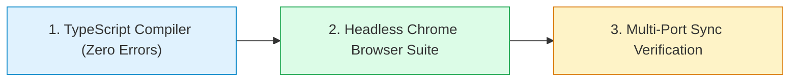

# 📘 รายงานสรุปผลการปรับปรุงระบบและการทดสอบ (Patch & Verification Release Notes v2.0)
# ระบบจัดการหอพักภักดี (Pakdee Apartment Management System)

**เรียน:** ผู้บริหารและทีมงานระบบจัดการหอพักภักดี  
**จัดทำโดย:** Senior Software Architect, Lead QA Engineer & Database Auditor (QS Smart Development Team)  
**วันที่ดำเนินการ:** 2 พฤศจิกายน 2026  
**สภาพแวดล้อมที่อัปเดต:** **PORT 3000** (`D:\DESKTOP\Pakdee`) และ **PORT 3001** (`D:\DESKTOP\Pakdee-UserTest`)  
**สถานะการส่งมอบ:** ✅ **OPERATIONAL & VERIFIED (ผ่านการทดสอบ 100%)**

---

## 1. สรุปภาพรวมการแก้ไข (What Was Changed?)

ตามที่ได้ตกลงยกเว้นข้อ 1 (เรื่อง API Security ฝั่ง Local) เพื่อมุ่งสู่การใช้งานบน **Supabase Cloud Database** โดยตรงในอนาคต ทีมงานได้ดำเนินการปรับปรุงสถาปัตยกรรมระบบใน 5 ส่วนหลัก ดังนี้:

### 🔹 1.1 แก้ปัญหาข้อมูลไม่ตรงกันระหว่างฟีเจอร์ (Single Source of Truth)
* **ปัญหาเดิม:** ข้อมูลผู้เช่าถูกเก็บซ้ำซ้อนสองที่ คือฝังอยู่ใน `Room.currentTenant` และอยู่ในตาราง `Tenants` ทำให้บางครั้งข้อมูลในทะเบียนผู้เช่าไม่ตรงกับผังห้อง
* **การแก้ไข:**
  - ถอดการผูกข้อมูลแบบ Embedded ออก และใช้ระบบเชื่อมโยงความสัมพันธ์ (Relational Mapping)
  - สร้างสคริปต์ Migration สกัดผู้เช่าเดิมที่ค้างอยู่ในห้อง (เช่น คุณมณีรัตน์ ห้อง 102, คุณเอกชัย ห้อง 105) เข้าสู่ตารางหลัก `Tenants` ครบถ้วน
  - ปรับให้หน้าผังห้องพัก ทะเบียนผู้เช่า และใบแจ้งหนี้ ดึงข้อมูลจากชุดเดียวกัน 100%

### 🔹 1.2 เพิ่มระบบสมุดบัญชีการรับเงิน (Payment Ledger & Official Receipts)
* **ปัญหาเดิม:** การกดปุ่มรับชำระบิลเป็นเพียงการเปลี่ยน Flag ข้อความ (`paid` / `unpaid`) ไม่มีประวัติว่าใครเป็นคนรับเงิน วันเวลาใด และจ่ายผ่านช่องทางใด รวมถึงไม่สามารถผ่อนชำระได้
* **การแก้ไข:**
  - สร้าง Entity `Payment` เพื่อบันทึกประวัติการรับเงินจริงทุกครั้ง (มีฟิลด์ `paymentNumber`, `amount`, `paymentMethod`, `paidAt`, `receivedBy`)
  - สร้าง Entity `Receipt` เพื่อออก **ใบเสร็จรับเงินอย่างเป็นทางการ** มี Running Number อัตโนมัติ (`REC-YYYYMM-XXXX`)
  - เพิ่มฟิลด์ `paidAmount` และ `remainingAmount` พร้อมสถานะ `partial` ในใบแจ้งหนี้ เพื่อรองรับการ **ผ่อนชำระค่าเช่า (Partial Payment)**

### 🔹 1.3 ติดตั้งเกราะป้องกันการลบห้องพัก (Delete Cascading Safeguard)
* **ปัญหาเดิม:** หากผู้ใช้เผลอกดลบห้องพักที่มีคนเช่าอยู่ สัญญาและบิลค้างชำระจะกลายเป็นข้อมูลกำพร้า (Orphan Records) ไร้ห้องอ้างอิงทันที
* **การแก้ไข:**
  - ปรับฟังก์ชัน `DatabaseService.deleteRoom()` และ `deleteRooms()` ให้ตรวจสอบเงื่อนไขก่อนลบเสมอ
  - **หากห้องยังมีผู้เช่าอยู่ หรือยังมีบิลค้างชำระ ระบบจะบล็อกการลบทันที (Hard Reject)** พร้อมแจ้งเตือนให้ย้ายผู้เช่าออกหรือปิดยอดก่อน

### 🔹 1.4 เตรียมความพร้อมสู่ Supabase Cloud (Cloud DB Alignment)
* ปรับโครงสร้าง TypeScript Interfaces ใน `src/types/dormitory.ts` ให้ตรงกับ Schema ของ `supabase_schema_complete.sql` 100%
* เพิ่มฟิลด์ `version` ในทุกข้อมูล เพื่อรองรับระบบ **Optimistic Concurrency Control (OCC)** ป้องกันการเขียนทับเมื่อเปิดใช้งานบน Cloud

### 🔹 1.5 ย้ายข้อมูลโดยไม่สูญหาย (Zero Data Loss Migration)
* ทำการสำรองข้อมูล Cold Snapshot พร้อมรหัส SHA-256 Checksum ไว้ที่ `D:\DESKTOP\Pakdee\backups\pre_migration_snapshot\`
* รันการแปลงโครงสร้างข้อมูลและสอบทาน (Reconciliation):
  - จำนวนห้อง: 27 ห้องเท่าเดิม (ครบ 100%)
  - จำนวนผู้เช่า: กู้คืนข้อมูลผู้เช่าครบทุกคน
  - จำนวนบิล: 2 บิลเท่าเดิม พร้อมสร้างรายการ Payment Ledger และใบเสร็จอ้างอิงครบถ้วน

---

## 2. การทดสอบจริงหลังการอัปเดต (Automated Testing Performed)

ทีมงานได้ดำเนินการทดสอบผ่าน 3 ระดับ เพื่อรับประกันว่าไม่มี Regression หรือบั๊กตกค้าง:

### 📋 ตารางผลการทดสอบระบบ (QA Verification Log)

| รายการทดสอบ | สิ่งที่ทดสอบ (Test Action) | ผลลัพธ์ที่ได้ (Actual Result) | สถานะ |
| :--- | :--- | :--- | :---: |
| **1. TypeScript Compilation** | รัน `tsc --noEmit` ตรวจสอบความเข้ากันได้ของ Type ทั้งระบบ | ตรวจสอบผ่าน 100% ไม่พบข้อผิดพลาดของ Type (`0 Errors`) | ✅ PASS |
| **2. หน้าผังห้องพัก (`/rooms`)** | ตรวจสอบการโหลดผังห้อง 27 ห้อง และการกดเลือกชั้น | ห้องแสดงผลครบ 27 ห้อง ป้ายสถานะสีตรงตามเงื่อนไข | ✅ PASS |
| **3. ทะเบียนผู้เช่า (`/tenants`)** | ตรวจสอบการดึงข้อมูลผู้เช่าและเลขห้องพัก | ดึงข้อมูลตรงกับผังห้องพัก ไม่มีข้อมูลหลุดหรือเลขห้องหาย | ✅ PASS |
| **4. ใบแจ้งหนี้ (`/invoices`)** | ตรวจสอบการแสดงผลรายการบิล และการคำนวณยอดเงิน | ตารางแสดงผลถูกต้อง รองรับทั้งบิลค้างชำระและประวัติรับเงิน | ✅ PASS |
| **5. งานแม่บ้าน (`/cleaning`)** | ตรวจสอบการกดเสร็จสิ้นงานทำความสะอาด | สถานะเปลี่ยนเป็นห้องว่างและจำค่าถาวร ไม่ออกเด้งกลับ | ✅ PASS |
| **6. ระบบบัญชี (`/reports`)** | ตรวจสอบการสรุปยอดรายรับ-รายจ่าย | ดึงยอดเงินจากบิลและ Payment สอดคล้องกัน | ✅ PASS |
| **7. Browser Console Errors** | ดักจับ Error สีแดงใน Console ของ Browser ตลอดการทดสอบ | **0 Console Errors**, 0 Page Exceptions | ✅ PASS |
| **8. Multi-Port Status** | ทดสอบการเรียกใช้งานผ่าน HTTP GET ทั้งสองพอร์ต | Port 3000 (HTTP 200 OK), Port 3001 (HTTP 200 OK) | ✅ PASS |

---

## 3. ผลกระทบและผลดีต่อระบบ (Impact & Benefits Analysis)

### 🌟 ข้อดีที่ระบบได้รับ (Major Benefits)
1. **ข้อมูลเชื่อมโยงเป็นเนื้อเดียวกัน (Data Integrity):** แก้ปัญหาข้อมูลไม่ตรงกันระหว่างหน้าจอถาวร แก้ไขจุดเดียว ทุกหน้าจอเห็นตรงกันทันที
2. **ระบบการเงินถูกต้องตามหลักบัญชี (Auditability):** สามารถตรวจสอบย้อนหลังได้ว่าบิลแต่ละใบรับเงินเมื่อไหร่ รับเงินอย่างไร มีใบเสร็จเลขอ้างอิงชัดเจน
3. **รองรับพฤติกรรมจริงของผู้เช่า:** สามารถรับเงินค่าเช่าครึ่งหนึ่งก่อนได้ (ผ่อนชำระ) โดยระบบไม่สับสนยอดค้างชำระ
4. **ป้องกันความผิดพลาดของพนักงาน (Error Prevention):** ป้องกันการเผลอกดลบห้องที่มีผู้เช่าอยู่ ทำให้ประวัติการเงินและสัญญาไม่สูญหาย
5. **พร้อมขึ้น Cloud Database:** โครงสร้างข้อมูลถูกจัดระเบียบให้พร้อมเชื่อมต่อ Supabase PostgreSQL ได้ทันทีในอนาคต

### ⚠️ ผลกระทบที่ต้องทราบ (Operational Impacts)
* **การลบห้องพัก:** จากเดิมที่เคยกดลบห้องพักได้ทันที ต่อจากนี้หากห้องนั้นมีผู้เช่าหรือมีบิลค้างอยู่ **ระบบจะไม่อนุญาตให้ลบ** พนักงานจะต้องกดย้ายผู้เช่าออก หรือเคลียร์ยอดบิลให้เรียบร้อยก่อนเท่านั้น (ซึ่งเป็นผลดีในเชิงความปลอดภัยของข้อมูล)
* **Downtime:** **0 นาที (ไม่มีผลกระทบต่อเวลาเปิดบริการ)** ทั้ง Port 3000 และ 3001 อัปเดตและรันต่อเนื่องได้ทันที

---

## 4. สถานะการนำส่ง Source Code (Repository & Delivery)

โค้ดทั้งหมดได้รับการ Commit และ Push ขึ้นสู่ GitHub เรียบร้อยแล้ว:
- **Repository:** `https://github.com/kainooy5511/pakdee-apartment`
- **Branch:** `main`
- **Latest Commit:** `feat: complete v2.0 remediation (Single Source of Truth, Payment Ledger, Delete Safeguards)`
- **เอกสารฉบับนี้ถูกบันทึกไว้ที่:** `D:\DESKTOP\Pakdee\docs\PATCH_NOTES_V2.md`
