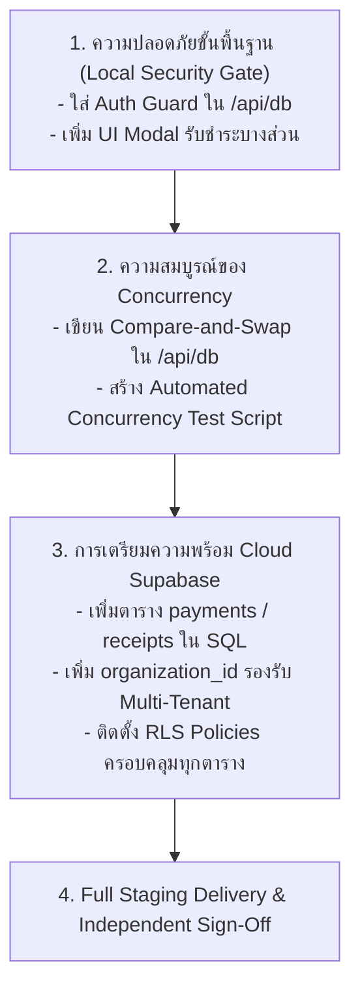

# ⚠️ ทะเบียนความเสี่ยงคงเหลือและแผนปฏิบัติการแก้ไข (REMAINING RISKS & ACTION PLAN)
# ระบบจัดการหอพักภักดี (Pakdee Apartment Management System)

**อ้างอิงเอกสารหลัก:** [V2_INDEPENDENT_VERIFICATION_REPORT.md](file:///D:/DESKTOP/Pakdee/docs/V2_INDEPENDENT_VERIFICATION_REPORT.md)  
**ขอบเขต:** สรุปความเสี่ยงที่ยังค้างอยู่ในระบบ พร้อมแผนปฏิบัติการแก้ไขที่ชัดเจนสำหรับทีมพัฒนา

---

## 1. ทะเบียนความเสี่ยงคงเหลือ (Remaining Risks Register)

| รหัส | รายการความเสี่ยงคงเหลือ | ระดับความรุนแรง | ผลกระทบหากไม่แก้ไข | แนวทางแก้ไขทางเทคนิค |
| :---: | :--- | :---: | :--- | :--- |
| **RSK-01** | `/api/db` ยังเปิดรับ Request แบบ Public ไม่มี Auth | **CRITICAL** | บุคคลในวง Wi-Fi/LAN สามารถแก้ไขหรือลบฐานข้อมูล JSON ได้ | ติดตั้ง Session/Token Middleware ตรวจสอบทุกคำขอที่เข้ามายัง `/api/db` |
| **RSK-02** | ยังไม่มี Optimistic Concurrency Control (OCC) จริง | **HIGH** | ข้อมูลเขียนทับกันสูญหายหากมีการใช้งานพร้อมกัน 2 เครื่องขึ้นไป | นำ Version Check มาใช้จริงใน `/api/db` และคืนค่า `409 Conflict` |
| **RSK-03** | Room ยังมี Embedded `currentTenant` ซ้อนทับกับ `tenants` | **MEDIUM** | ข้อมูลอาจไม่ตรงกันหากมีการแก้ไขผู้เช่าผ่านหน้าจอโดยไม่ซิงค์ห้อง | ลบ `currentTenant` ออกจาก `Room` และดึงข้อมูลผ่าน Active Contract เสมอ |
| **RSK-04** | ขาดหน้าต่าง UI สำหรับการรับชำระบางส่วน (Partial Payment Modal) | **MEDIUM** | ผู้ใช้จริงยังกดแบ่งจ่ายผ่านหน้าเว็บไม่ได้ แม้ Backend จะมีฟังก์ชันรองรับแล้ว | เพิ่มปุ่มและหน้าต่างกรอกยอดเงินที่ชำระจริงใน `advanced-billing-view.tsx` |
| **RSK-05** | SQL Schema ยังไม่มีตาราง `payments`, `receipts`, และ `organization_id` | **HIGH** | ไม่สามารถย้ายขึ้น Supabase ได้ทันทีหากยังไม่อัปเดตสคริปต์ SQL | แก้ไข `supabase_schema_complete.sql` ให้มีตารางการเงินครบถ้วน |

---

## 2. แผนปฏิบัติการสู่ Staging และ Cloud (Action Plan Roadmap)

---

## 3. สรุปคำแนะนำสำหรับการเปิดใช้งาน (Auditor Recommendation)

1. **สำหรับทดสอบภายในเครื่องเดียว (Local Standalone):**  
   - สามารถใช้งานทดสอบ Flow ทั่วไปบน **Port 3000** และ **Port 3001** ได้อย่างปลอดภัย ภายใต้สภาพแวดล้อมที่ควบคุมได้
2. **สำหรับการเปิดให้ลูกค้าภายนอกใช้งานจริง (Production / Cloud SaaS):**  
   - **ห้ามเปิดให้บริการจนกว่าจะดำเนินการตาม Phase 1, Phase 2 และ Phase 3 ครบถ้วน** เพื่อป้องกันปัญหาข้อมูลสูญหายและการถูกแฮกข้อมูลในระดับเครือข่าย
